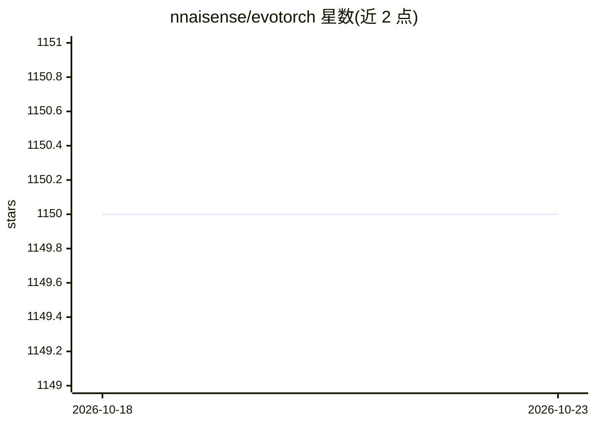

# nnaisense/evotorch

⭐ 1,150 · Python · Apache-2.0 · 推送 2026-10-19 · [GitHub](https://github.com/nnaisense/evotorch) · [官网](https://evotorch.ai) · 组织维护

**给研究与开发者的 PyTorch 进化计算与神经进化库**

由 NNAISENSE 开发、构建在 PyTorch 之上的开源进化计算库。可求解黑盒优化（连续/离散）、强化学习、监督学习等可微与不可微问题。内置分布类搜索算法（PGPE、XNES、CMA-ES、SNES、CEM）与种群类算法（遗传算法/NSGA-II、CoSyNE、MAPElites）；因基于 PyTorch 实现可利用 GPU 向量化加速，并通过 Ray 将任务分布到多 CPU、多 GPU 与集群。以 pip 安装的 Python 库形式提供，附黑盒优化与 gym 强化学习代码示例，可引用其 arXiv 论文。

## 筛选速览

| 维度 | 判定 | 备注 |
|---|---|---|
| AI 角色 | `ai-ecosystem` | LLM/agent 周边工具 |
| 许可风险 | `permissive` | Apache-2.0 |
| 部署形态 | `library` | 以包/库形式分发 |
| 模型依赖 | — | README 未给出锁定关系 |
| 硬件要求 | — | 无带数字的原话,不猜 |
| 安装摩擦 | `low` | 无编译、无系统依赖或容器化 |
| 成熟度 | — | 结构信号不足 |

## 能力要点

- 内置 PGPE/XNES/CMA-ES/SNES/CEM 等分布类搜索算法
- 遗传算法（多目标时表现为 NSGA-II）、CoSyNE、MAPElites 等种群类算法
- 基于 PyTorch 实现，支持 GPU 向量化加速
- 通过 Ray 扩展到多 CPU、多 GPU 与集群

## 适用场景

- 求解不可微的黑盒优化问题
- 用 PGPE/GymNE 等做神经进化式强化学习
- 需要 GPU 与集群扩展的进化计算研究

## 场景标签

`强化学习` · 领域:训练与推理

## 证据(README 行号)

> L28: EvoTorch is an open source evolutionary computation library developed at NNAISENSE, built on top of PyTorch.
> L36: With EvoTorch, one can solve various optimization problems, regardless of whether they are differentiable (i.e. all
> L53: Since all of these algorithms are implemented in PyTorch, they benefit from use of vectorization and parallelizatio

## 星数曲线

2026-10-18 1,150 → 2026-10-23 1,150（+0）

---
*卡片 v1 · prompt 1.4 · 生成 2026-10-21 · 置信度 high · 依据 README sha `c44f815d2a48` · [字段定义](../../DATASET.md)*
