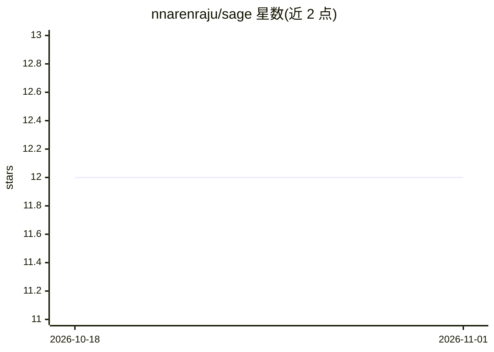

# nnarenraju/sage

⭐ 12 · Jupyter Notebook · GPL-3.0 · 推送 2026-10-30 · [GitHub](https://github.com/nnarenraju/sage) · [官网](https://sage-gw.readthedocs.io/en/latest/) · 组织维护

**引力波致密双并合信号的端到端深度学习检测流水线**

面向引力波研究的机器学习搜索流水线：训练全程即时生成波形与噪声窗口，无需预生成数据集；识别并缓解 11 种影响检测性能的监督学习偏差；包含 GWOSC 数据下载、真实噪声模拟、双黑洞波形生成（IMRPhenomD/PhenomPv2）、多探测器投影、白化与信号压缩、模块化网络架构、训练验证与诊断绘图等模块。模块针对 CPU 与 GPU 优化；CUDA GPU 为建议配置而非硬性要求。提供 conda 与 pip 两种本地可编辑安装方式及 Google Colab 教程。

## 筛选速览

| 维度 | 判定 | 备注 |
|---|---|---|
| AI 角色 | `ai-native` | 本体是模型或模型工具 |
| 许可风险 | `viral` | GPL-3.0 |
| 部署形态 | `library` | 以包/库形式分发 |
| 模型依赖 | — | README 未给出锁定关系 |
| 硬件要求 | — | 无带数字的原话,不猜 |
| 安装摩擦 | `medium` | 含编译或系统依赖之一 |
| 成熟度 | — | 结构信号不足 |

## 能力要点

- 训练全程即时生成波形与噪声，无需预生成数据集
- 系统识别并缓解 11 种监督学习偏差
- 覆盖数据下载、噪声模拟、波形生成、训练与诊断的完整模块
- 提供 Google Colab 免安装教程与复现实验脚本

## 适用场景

- 在引力波探测器数据中搜索致密双并合信号
- 复现论文中的 ML 偏差识别与缓解实验
- 在 Colab T4 上免本地安装学习引力波信号处理流程

## 场景标签

`教程课程` `科研工具` · 领域:学习与行业

## 证据(README 行号)

> L13: Sage is a machine-learning based search pipeline for compact binary coalescence
> L24: Sage is a complete, end-to-end machine-learning pipeline for gravitational-wave compact binary coalescence detectio

## 星数曲线

2026-10-18 12 → 2026-11-01 12（+0）

---
*卡片 v1 · prompt 1.4 · 生成 2026-11-01 · 置信度 high · 依据 README sha `0cb9cb49f210` · [字段定义](../../DATASET.md)*
