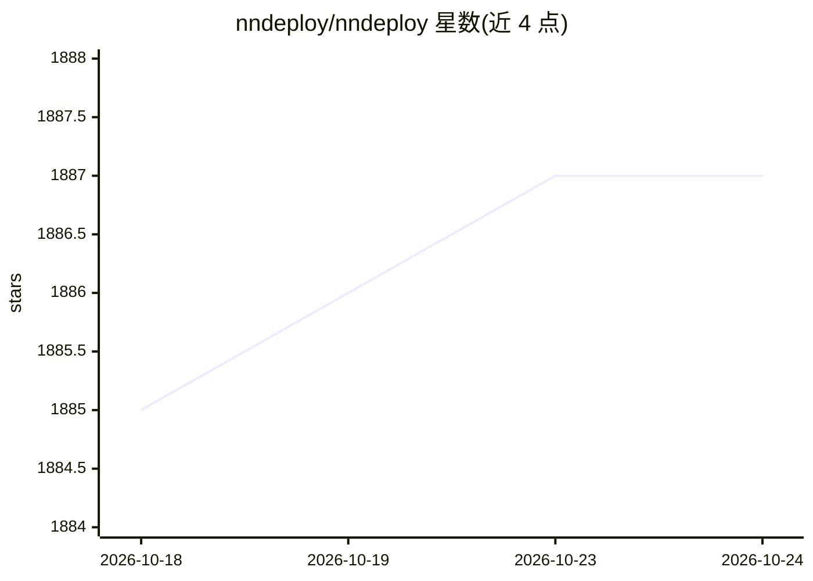

# nndeploy/nndeploy

⭐ 1,887 · C++ · Apache-2.0 · 推送 2026-08-15 · [GitHub](https://github.com/nndeploy/nndeploy) · [官网](https://nndeploy-zh.readthedocs.io/zh-cn/latest/) · 组织维护 · 中文 README

**跨端 AI 部署框架：可视化工作流+多推理后端落地算法**

面向 AI 算法端侧部署的框架，覆盖桌面、移动端、边缘设备（Jetson、Ascend310B、RK）与服务器。核心机制：可视化工作流拖拽搭节点、导出 JSON 后经 C++/Python API 在生产环境运行；深度集成 13 种推理框架（ONNXRuntime、TensorRT、MNN、TNN 等）；内置并行执行模式与零拷贝等内存优化；已部署 LLM、文生图、OCR、检测等 100+ 节点。pip 安装默认含 ONNXRuntime 与 MNN，要求 Python 3.10+，其他后端需开发者模式编译。

## 筛选速览

| 维度 | 判定 | 备注 |
|---|---|---|
| AI 角色 | `ai-ecosystem` | LLM/agent 周边工具 |
| 许可风险 | `permissive` | Apache-2.0 |
| 部署形态 | `library` | 以包/库形式分发 |
| 模型依赖 | — | README 未给出锁定关系 |
| 硬件要求 | — | 无带数字的原话,不猜 |
| 安装摩擦 | `medium` | 含编译或系统依赖之一 |
| 成熟度 | — | 结构信号不足 |

## 能力要点

- 可视化工作流拖拽部署，导出 JSON 由 C++/Python API 调用
- 集成 13 种推理框架（ONNXRuntime/TensorRT/OpenVINO/MNN 等）
- 串行/流水线并行/任务并行执行模式，零拷贝、内存池优化
- 100+ 开箱即用节点：LLM、Stable Diffusion、YOLO 系列、PaddleOCR 等

## 适用场景

- 把检测、分割、OCR 等 AI 模型部署到手机或边缘设备
- 在可视化界面搭好工作流后导出到生产环境跨平台运行
- 针对 10B 以上大模型与 AIGC 模型搭建可视化工作流
- 为同一工作流在不同硬件上切换推理后端

## 场景标签

`推理引擎` · 领域:训练与推理

## 证据(README 行号)

> L30: nndeploy 是一款简单易用和高性能的 AI 部署框架。解决的是 AI 算法在端侧部署的问题，包含桌面端（Windows、macOS）、移动端（Android、iOS）、边缘计算设备（NVIDIA Jetson、Ascend3
> L48: - **多端推理**：一套工作流适配多端推理，深度集成 13 种主流推理框架，全面覆盖云端服务器、桌面应用、移动设备、边缘计算等全平台部署场景。框架支持灵活选择推理引擎，可按需编译减少依赖，同时支持接入自定义推理框架的独立运行模式
> L68: 已部署多类 AI 模型，并开发 100+可视化节点，实现开箱即用体验。随着部署节点数量的增加，节点库的复用性不断提升，这将显著降低后续算法部署的开发成本。我们还将持续部署更多具有实用价值的算法。

## 星数曲线

2026-10-18 1,885 → 2026-10-24 1,887（+2）

---
*卡片 v1 · prompt 1.4 · 生成 2026-10-21 · 置信度 high · 依据 README sha `f73d363f2cdc` · [字段定义](../../DATASET.md)*
