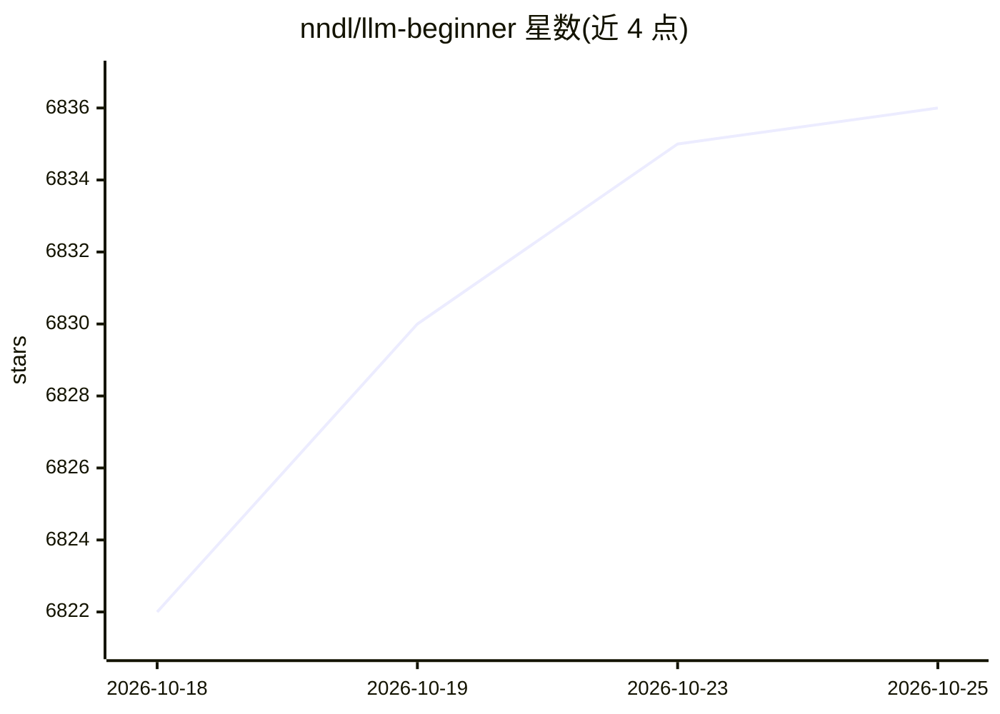

# nndl/llm-beginner

⭐ 6,838 · Python · MIT · 推送 2026-09-06 · [GitHub](https://github.com/nndl/llm-beginner) · [官网](https://nndl.ai/llm-agent/) · 组织维护 · 中文 README

**面向学习者的《大模型与智能体》电子书与 6 项编程任务教程**

由邱锡鹏（复旦 NLP 组）编写的中文电子书（17 章）配套 6 个循序渐进的编程任务：手写 Transformer、从零实现 mini-GPT、手写 LoRA 做 SFT/DPO、构建 RAG 问答、实现 ReAct 工具调用 Agent、构建含 MCP/Skill/Subagent 的编程智能体。每项任务提供依赖文件、数据/模型下载脚本、按接口约定评分的自检脚本，以及可贴给大模型做代码 review 的提示词；实现代码由学习者在 src/ 中完成。以 Qwen2.5 系列为贯穿基座模型，本地化优先，支持 HF 镜像与 ModelScope 下载。需要 Python 3.10+ 与深度学习基础，书稿处于出版筹备阶段、内容随修订更新。

## 筛选速览

| 维度 | 判定 | 备注 |
|---|---|---|
| AI 角色 | `ai-knowledge` | 知识聚合/清单类 |
| 许可风险 | `permissive` | MIT |
| 部署形态 | `library` | 以包/库形式分发 |
| 模型依赖 | — | README 未给出锁定关系 |
| 硬件要求 | — | 无带数字的原话,不猜 |
| 安装摩擦 | `low` | 无编译、无系统依赖或容器化 |
| 成熟度 | `idea` | |

## 能力要点

- 6 项任务沿 Transformer→mini-GPT→SFT/DPO→RAG→工具调用→编程智能体推进
- 每任务提供数据下载脚本、接口约定与自检脚本（eval/run.py 输出结构化结果）
- 先手写关键组件再对照框架（PEFT、Qwen-Agent、smolagents 等）的教学路线
- tutor_prompt.md 可贴给 Claude/Qwen/DeepSeek 等做代码 review

## 适用场景

- 系统入门大模型与智能体原理并动手实践
- 通过自检脚本逐步完成从注意力到编程智能体的实现
- 想学 RAG、LoRA 微调或 Agent 循环实现的开发者按需选做单项任务

## 场景标签

`教程课程` · 领域:学习与行业

## 证据(README 行号)

> L3: **《大模型与智能体》电子书与 6 个循序渐进的编程任务**
> L18: LLM-Beginner 由 NLP-Beginner重构而来，沿着 Transformer → mini-GPT → 微调与对齐 → RAG → 工具调用 → 编程智能体逐步推进。每项任务先实现关键组件，再对照框架，并用自检脚本
> L40: 六个任务目录结构一致：每个任务下都有 `requirements.txt`（依赖）、`data/download.py`（下载数据 / 模型）、`eval/run.py`（自检脚本）和 `eval/tutor_prompt.md`

## 星数曲线

2026-10-18 6,822 → 2026-10-25 6,836（+14）

---
*卡片 v1 · prompt 1.4 · 生成 2026-10-20 · 置信度 high · 依据 README sha `883cfad259a0` · [字段定义](../../DATASET.md)*
