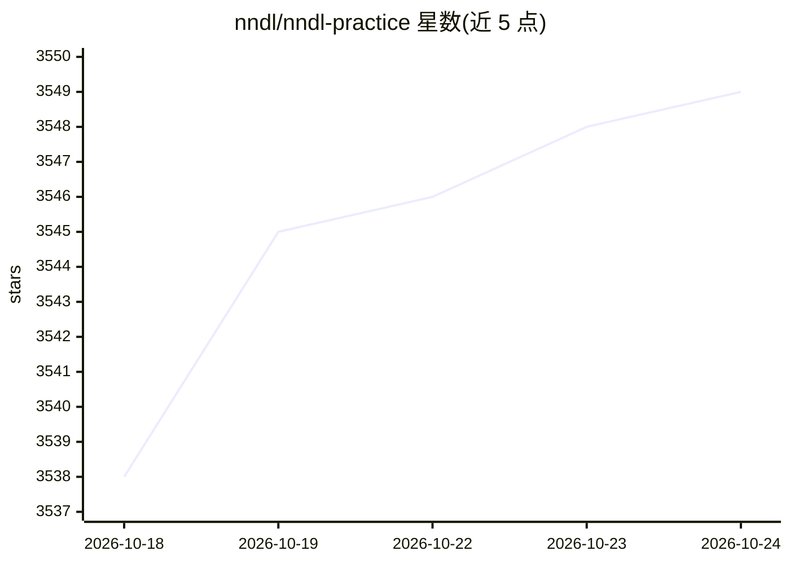

# nndl/nndl-practice

⭐ 3,549 · Jupyter Notebook · 推送 2026-09-07 · [GitHub](https://github.com/nndl/nndl-practice) · [官网](https://nndl.ai/nndl-practice/) · 组织维护 · 中文 README

**深度学习实践教材配套代码库：10 章 PyTorch Notebook 与测试**

《神经网络与深度学习：案例与实践（第二版）》配套代码仓库，由邱锡鹏著。全书 10 章，从线性模型、CNN、RNN 到注意力机制、图神经网络、大语言模型与智能体，提供 Notebook、逐章实现说明与 pytest sanity 测试。代码随章节逐步搭建轻量学习框架 nndl（RunnerV1-V3 与算子、模型），关键组件先展示完整实现再复用工程化版本。面向有 Python 基础的学生与工程师，需 Python 3.11+、PyTorch 2.7+，Notebook 默认 CPU。当前处于出版筹备阶段，内容持续修订。

## 筛选速览

| 维度 | 判定 | 备注 |
|---|---|---|
| AI 角色 | `ai-knowledge` | 知识聚合/清单类 |
| 许可风险 | `none` | — |
| 部署形态 | `library` | 以包/库形式分发 |
| 模型依赖 | — | README 未给出锁定关系 |
| 硬件要求 | — | 无带数字的原话,不猜 |
| 安装摩擦 | `low` | 无编译、无系统依赖或容器化 |
| 成熟度 | `idea` | |

## 能力要点

- 10 章覆盖 CNN/RNN/注意力/GNN/LLM 与智能体（nanoGPT、LoRA、DPO、ReAct、RAG）
- 随章节搭建可复用学习框架 pytorch/nndl（RunnerV1-V3）
- 每章附 pytest sanity 测试检查算子与模型形状

## 适用场景

- 动手学习深度学习并搭配理论书阅读
- 按 CV 或序列建模等目标选择章节路径
- 复现书中关键算法实现并运行测试

## 场景标签

`教程课程` · 领域:学习与行业

## 证据(README 行号)

> L10:  本书把神经网络模型、深度学习原理和工程实践放在同一条学习线上：一边理解模型，一边用 PyTorch 从零实现关键组件，再把它们用于可运行的案例。
> L11:  全书共 10 章，仓库提供配套 Notebook、逐章实现说明和测试。从线性模型、卷积网络和循环网络出发，逐步进入注意力机制、图神经网络、大语言模型与智能体。

## 星数曲线

2026-10-18 3,538 → 2026-10-24 3,549（+11）

---
*卡片 v1 · prompt 1.4 · 生成 2026-10-20 · 置信度 mid · 依据 README sha `adb06bbf8e19` · [字段定义](../../DATASET.md)*
