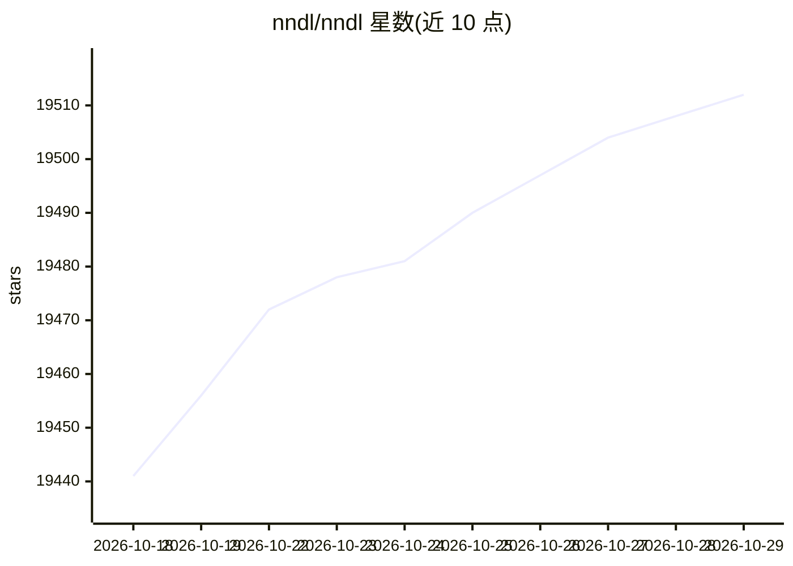

# nndl/nndl

⭐ 19,512 · 推送 2026-09-06 · [GitHub](https://github.com/nndl/nndl) · [官网](https://nndl.ai/) · 组织维护 · 中文 README

**深度学习教材读者：获取邱锡鹏《神经网络与深度学习》电子书与勘误**

该仓库是邱锡鹏《神经网络与深度学习》第二版与通识版的资料入口：提供两本书的开放电子稿 PDF 下载、16 章目录与勘误渠道，勘误通过 GitHub Issues 提交并注明版本与页码。第二版（蒲公英书）面向专业课程与研究入门，需线性代数、微积分与概率论基础，配套 PyTorch 实践；通识版面向非专业读者与高校通识课。第一版资料归档在 legacy 目录与 nndl-v1 分支，LaTeX 源码不在公开仓库中。

## 筛选速览

| 维度 | 判定 | 备注 |
|---|---|---|
| AI 角色 | `ai-knowledge` | 知识聚合/清单类 |
| 许可风险 | `none` | — |
| 部署形态 | `None` |  |
| 模型依赖 | — | README 未给出锁定关系 |
| 硬件要求 | — | 无带数字的原话,不猜 |
| 安装摩擦 | `low` | 无编译、无系统依赖或容器化 |
| 成熟度 | — | 结构信号不足 |

## 动量与使用信号

- 维护:`active` — 距上次 push 42.1 天,年发版 1,8 位贡献者
- 涨星:近 1 天 **+6**(自 20261016 起算)

## 能力要点

- 提供第二版与通识版开放电子稿 PDF，内容随修订更新
- 第二版 16 章加 5 个数学基础附录，含注意力机制与 Transformer、图神经网络、大语言模型等章节
- 通识版 16 章，覆盖大模型、智能体、多模态、具身智能与 AI 安全
- 第一版资料归档于 legacy/nndl-v1 目录与 nndl-v1 分支，含各章 PDF 与教学幻灯片

## 适用场景

- 系统学习神经网络与深度学习的理论与数学推导
- 高校通识课或跨学科读者建立对 AI 的直觉理解
- 向作者反馈教材勘误或提交改进建议

## 场景标签

`教程课程` · 领域:学习与行业

## 证据(README 行号)

> L3: 邱锡鹏著 · **第二版与通识版的电子书、目录和勘误入口**
> L15:  从机器学习基础出发，系统讲解神经网络、优化、Transformer、图神经网络、强化学习、生成模型与大语言模型。
> L23:  用故事、案例和生活类比解释神经网络与深度学习，并延伸到大语言模型、智能体、多模态、科学智能、具身智能、AI 安全与未来。

## 星数曲线

2026-10-18 19,441 → 2026-10-29 19,512（+71）

---
*卡片 v1 · prompt 1.4 · 生成 2026-10-18 · 置信度 high · 依据 README sha `9254d1b18794` · [字段定义](../../DATASET.md)*
