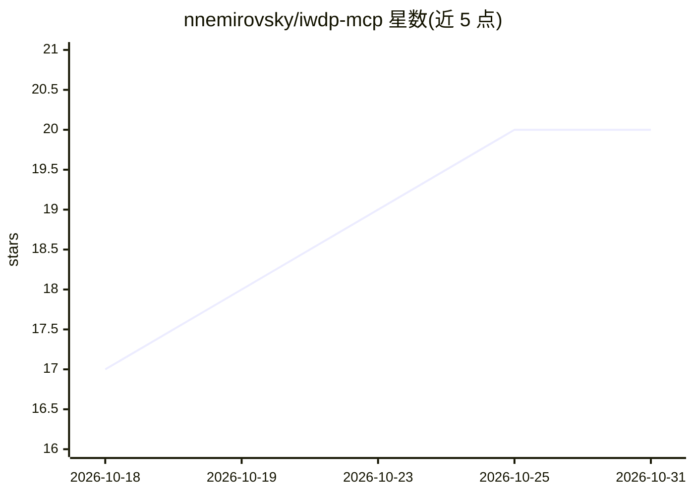

# nnemirovsky/iwdp-mcp

⭐ 20 · Go · MIT · 推送 2026-10-03 · [GitHub](https://github.com/nnemirovsky/iwdp-mcp) · 个人维护

**让 AI agent 调试 iOS Safari 的 MCP server + CLI**

基于 Go 的 MCP server 与 CLI，通过 ios-webkit-debug-proxy 连接 USB 上的 iPhone，封装 WebKit Inspector Protocol 全部 27 个域名共 100+ 工具：导航、截图、DOM/CSS 检查、网络拦截、httpOnly cookie 读取、JS 断点调试、堆快照与性能分析，另有 click/fill 等元素交互。MCP server 与 CLI 功能对等，可接入 Claude Code、VS Code、Cursor、Windsurf、Codex、JetBrains 等客户端。前置条件：安装 ios-webkit-debug-proxy 并在设备上启用 Web Inspector。

## 筛选速览

| 维度 | 判定 | 备注 |
|---|---|---|
| AI 角色 | `ai-ecosystem` | LLM/agent 周边工具 |
| 许可风险 | `permissive` | MIT |
| 部署形态 | `library` | 以包/库形式分发 |
| 模型依赖 | — | README 未给出锁定关系 |
| 硬件要求 | — | 无带数字的原话,不猜 |
| 安装摩擦 | `low` | 无编译、无系统依赖或容器化 |
| 成熟度 | — | 结构信号不足 |

## 能力要点

- 100+ 工具覆盖 WebKit Inspector Protocol 全部 27 个域
- 经由协议读取 httpOnly/secure cookie 与网络响应体
- 支持 JS 断点、堆快照、CPU/时间线性能分析
- MCP server 与 CLI 功能完全对等，接入多种 MCP 客户端

## 适用场景

- 让 AI 助手直接调试真机 iOS Safari 页面
- 自动化移动端网页的检查、截图与网络监控
- 排查 iOS 特有、模拟器难以复现的前端问题

## 场景标签

`浏览器自动化` · 领域:效率与自动化

## 证据(README 行号)

> L17: **Debug iOS Safari from your AI agent.** No existing tool lets AI assistants interact with Safari on a real iPhone.
> L28: - Works with **Claude Code, VS Code, Cursor, Windsurf, Codex CLI, Antigravity, JetBrains**, and any MCP-compatible 
> L267: ┌────────────┐    USB     ┌──────────┐   HTTP/WS    ┌──────────┐

## 星数曲线

2026-10-18 17 → 2026-10-31 20（+3）

---
*卡片 v1 · prompt 1.4 · 生成 2026-10-28 · 置信度 high · 依据 README sha `72b4d706723b` · [字段定义](../../DATASET.md)*
