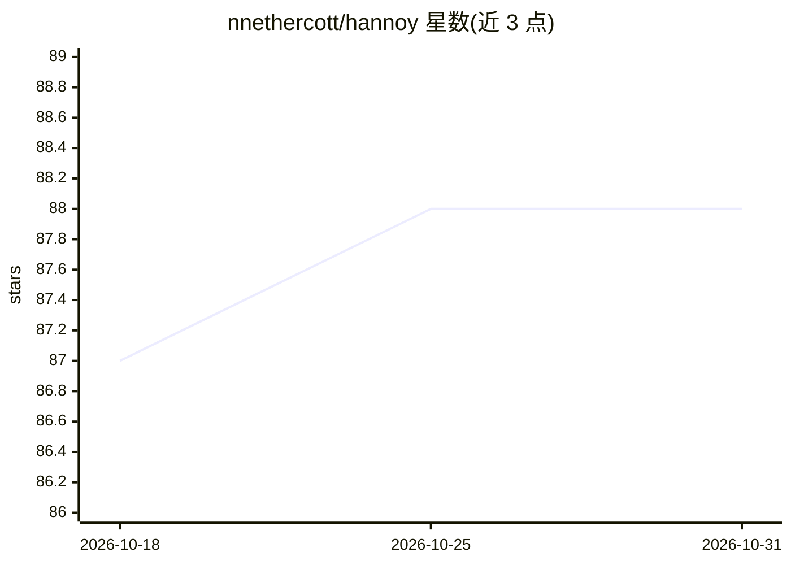

# nnethercott/hannoy

⭐ 88 · Rust · MIT · 推送 2026-10-22 · [GitHub](https://github.com/nnethercott/hannoy) · [官网](https://docs.rs/hannoy) · 个人维护

**LMDB 磁盘存储后端的 HNSW 近似最近邻库（Rust/Python）**

基于 arroy 的 HNSW 近似最近邻检索实现，使用 LMDB（内存映射 KV 存储）作为后端，支持索引超出内存容量的数据集，并支持非阻塞并发读。提供 Rust crate 与经 maturin/pyo3 构建的 Python 绑定，支持 euclidean/cosine/manhattan/hamming 及量化度量、rayon 多线程构建、压缩位图存储图边（每向量约 200 字节）、动态插入删除无需全量重建。缺少 GPU 加速索引。可通过环境变量配置 madvise 预取以降低冷启动延迟。

## 筛选速览

| 维度 | 判定 | 备注 |
|---|---|---|
| AI 角色 | `ai-ecosystem` | LLM/agent 周边工具 |
| 许可风险 | `permissive` | MIT |
| 部署形态 | `library` | 以包/库形式分发 |
| 模型依赖 | — | README 未给出锁定关系 |
| 硬件要求 | — | 无带数字的原话,不猜 |
| 安装摩擦 | `low` | 无编译、无系统依赖或容器化 |
| 成熟度 | — | 结构信号不足 |

## 能力要点

- LMDB 磁盘后端，可索引超出 RAM 的数据集
- 支持 euclidean/cosine/manhattan/hamming 及量化度量
- Python 绑定（maturin + pyo3），支持 numpy float32 批量写入
- 动态插入删除无需全量重建，压缩位图存边约 200 字节/向量

## 适用场景

- 在内存受限或运行多个程序的单机上做向量检索
- 为应用构建磁盘持久的近似最近邻索引
- 通过 Python 绑定用 numpy 数组批量写入向量

## 场景标签

`向量数据库` · 领域:知识与检索

## 证据(README 行号)

> L10: hannoy is a key-value backed HNSW implementation based on arroy.
> L19: - Disk-backed storage to enable indexing datasets that won't fit in RAM using LMDB

## 星数曲线

2026-10-18 87 → 2026-10-31 88（+1）

---
*卡片 v1 · prompt 1.4 · 生成 2026-10-23 · 置信度 high · 依据 README sha `8babe0d1d3ef` · [字段定义](../../DATASET.md)*
