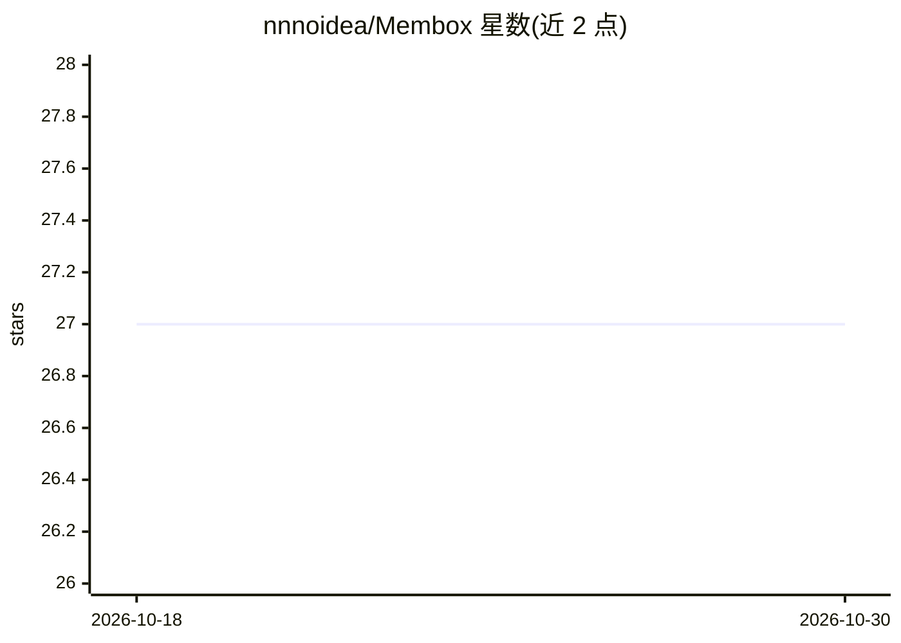

# nnnoidea/Membox

⭐ 27 · Python · 推送 2026-08-06 · [GitHub](https://github.com/nnnoidea/Membox) · 个人维护

**LLM agent 长程对话记忆架构：主题连续的记忆盒加事件链检索**

面向 LLM agent 的长程对话记忆架构：先构建围绕主题连续性的记忆盒（Topic Loom），再用事件级 Trace Weaver 图将记忆盒连接，保留时序、因果与主题结构。回答生成阶段采用 trace-aware 上下文构建：检索 top 记忆盒后，以盒中事件为种子在图中扩展事件链，拼入回答提示词。在 LoCoMo 基准上报告 Membox-Compact 与 Membox-Trace 两种设置的结果，需配置 OpenAI API key，通过分阶段 CLI 运行 build/trace/retrieve/generate 流程。

## 筛选速览

| 维度 | 判定 | 备注 |
|---|---|---|
| AI 角色 | `ai-ecosystem` | LLM/agent 周边工具 |
| 许可风险 | `none` | — |
| 部署形态 | `library` | 以包/库形式分发 |
| 模型依赖 | — | README 未给出锁定关系 |
| 硬件要求 | — | 无带数字的原话,不猜 |
| 安装摩擦 | `low` | 无编译、无系统依赖或容器化 |
| 成熟度 | — | 结构信号不足 |

## 能力要点

- 记忆盒 + 事件级 trace 图的主题连续性记忆结构
- trace-aware 上下文构建：以检索盒内事件为种子扩展事件链拼入提示词
- 支持 build/trace/retrieve/generate 分阶段运行与 --trace-event-topn 调节
- 报告 LoCoMo 基准上多跳/时序/开放域/单跳四类 F1/BLEU-1 结果

## 适用场景

- 为 LLM agent 提供长程对话记忆并回答跨时段问题
- 在 LoCoMo 基准上复现记忆架构实验结果
- 研究记忆盒内容与事件链上下文对长程问答的影响（消融）

## 场景标签

`Agent 记忆` `模型评测` · 领域:Agent 开发

## 证据(README 行号)

> L5: MemBox is a memory architecture for long-range conversational memory in LLM agents. It is built around topic continu
> L93: python membox.py --stage all --run-id test_run

## 星数曲线

2026-10-18 27 → 2026-10-30 27（+0）

---
*卡片 v1 · prompt 1.4 · 生成 2026-10-26 · 置信度 high · 依据 README sha `ee30c154ea6d` · [字段定义](../../DATASET.md)*
