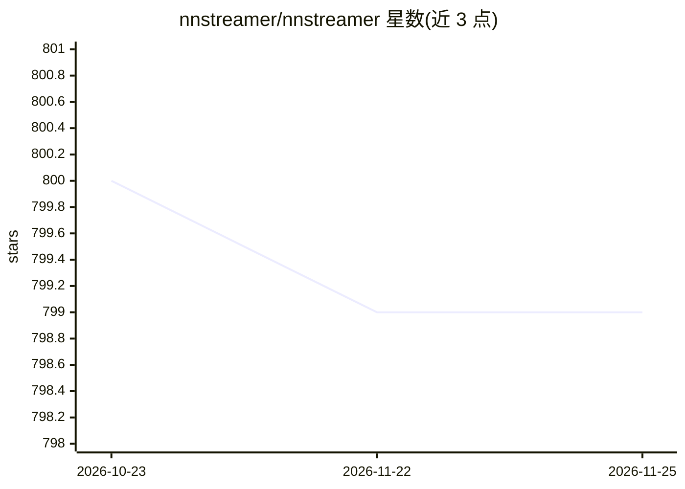

# nnstreamer/nnstreamer

⭐ 799 · C++ · LGPL-2.1 · 推送 2026-11-21 · [GitHub](https://github.com/nnstreamer/nnstreamer) · [官网](https://nnstreamer.ai) · 组织维护

**帮助开发者以 GStreamer 插件形式接入神经网络模型**

NNStreamer 是一组 GStreamer 插件，让 GStreamer 开发者可将神经网络模型作为媒体过滤器接入流管线，也供神经网络开发者管理和构建带模型过滤器的流管线。支持在同一管线中组合多个模型与多路数据源。提供 Tizen、Ubuntu、Android、Yocto、macOS 的官方发布渠道，提供 C/C#/Java API，并通过子插件对接多种推理后端与硬件加速器。

## 筛选速览

| 维度 | 判定 | 备注 |
|---|---|---|
| AI 角色 | `ai-ecosystem` | LLM/agent 周边工具 |
| 许可风险 | `viral` | LGPL-2.1 |
| 部署形态 | `None` |  |
| 模型依赖 | — | README 未给出锁定关系 |
| 硬件要求 | — | 无带数字的原话,不猜 |
| 安装摩擦 | `low` | 无编译、无系统依赖或容器化 |
| 成熟度 | `idea` | |

## 能力要点

- 以 GStreamer 插件形式将神经网络模型用作媒体过滤器
- 支持单管线组合多个模型与多模态多路流
- 通过子插件对接 TensorRT、OpenVINO、Edge-TPU、SNPE、QNN 等加速后端
- 覆盖 Tizen/Ubuntu/Android/Yocto/macOS 平台发布与 C/C#/Java API

## 适用场景

- 在媒体流管线中嵌入图像分类、目标检测、姿态估计模型
- 在边缘设备上构建流式 AI 推理管线
- 统一管理包含多个神经网络模型的流处理应用

## 场景标签

`推理引擎` · 领域:训练与推理

## 证据(README 行号)

> L14: NNStreamer is a set of Gstreamer plugins that allow
> L47: - Provide neural network framework connectivities (e.g., tensorflow, caffe) for gstreamer streams.
> L126: Although a framework may accelerate transparently as Tensorflow-GPU does, nnstreamer provides various hardware acc

## 星数曲线

2026-10-23 800 → 2026-11-25 799（-1）

---
*卡片 v1 · prompt 1.4 · 生成 2026-11-24 · 置信度 high · 依据 README sha `bafee3cae021` · [字段定义](../../DATASET.md)*
