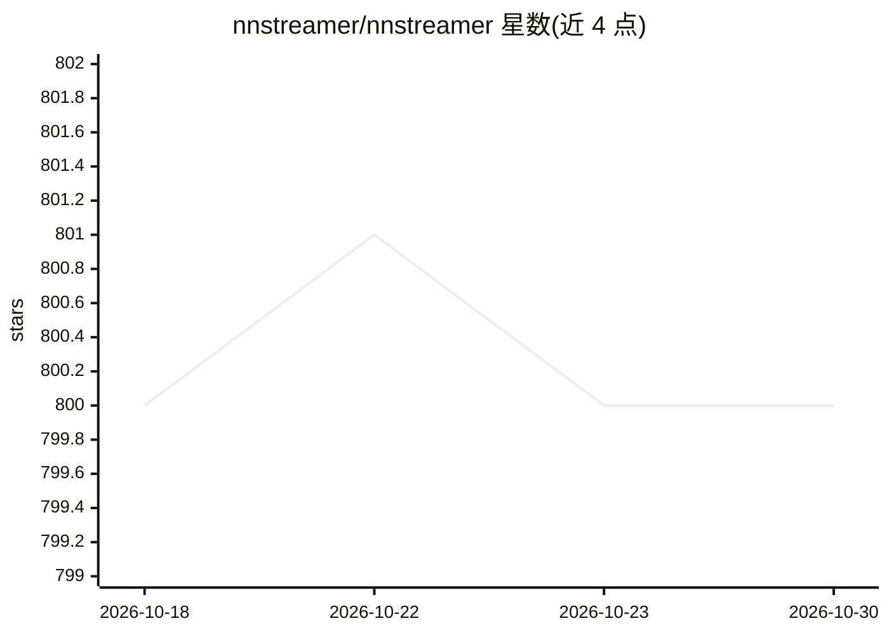

# nnstreamer/nnstreamer

⭐ 800 · C++ · LGPL-2.1 · 推送 2026-10-29 · [GitHub](https://github.com/nnstreamer/nnstreamer) · [官网](https://nnstreamer.ai) · 组织维护

**把神经网络模型接入 GStreamer 流水线的插件集，面向嵌入式/边缘设备**

NNStreamer 是一组 GStreamer 插件，使 GStreamer 开发者能在媒体流中直接使用神经网络模型作为过滤器，也使神经网络开发者便于构建和管理媒体流管道。支持多模型组合、多模态来源接入，提供与 TensorFlow、Caffe2、PyTorch、TensorFlow-lite、TVM 等框架的连接，以及 TensorRT、Edge-TPU、SNPE、ARMNN 等多种 AI 加速硬件子插件。发布渠道覆盖 Tizen、Ubuntu（PPA）、Android、Yocto、macOS（Brew Tap）。README 注明项目起步阶段、部分组件仍在设计期。

## 筛选速览

| 维度 | 判定 | 备注 |
|---|---|---|
| AI 角色 | `ai-ecosystem` | LLM/agent 周边工具 |
| 许可风险 | `viral` | LGPL-2.1 |
| 部署形态 | `None` |  |
| 模型依赖 | — | README 未给出锁定关系 |
| 硬件要求 | — | 无带数字的原话,不猜 |
| 安装摩擦 | `low` | 无编译、无系统依赖或容器化 |
| 成熟度 | `idea` | |

## 能力要点

- 将 NN 模型作为 GStreamer 媒体过滤器在流管道中使用
- 单一管道中组合多个模型、接入多模态来源
- 支持 TensorRT、Edge-TPU、SNPE、QNN、ARMNN 等多种加速硬件子插件
- 覆盖 Tizen/Ubuntu/Android/Yocto/macOS 多平台官方发布渠道

## 适用场景

- 在音视频媒体流中做姿态估计、图像分类、目标检测
- 边缘设备上构建多模型、多模态的 AI 流水线
- GStreamer 应用中接入 TensorFlow/PyTorch 等框架模型

## 场景标签

`推理引擎` · 领域:训练与推理

## 证据(README 行号)

> L14: NNStreamer is a set of Gstreamer plugins that allow
> L15: Gstreamer developers to adopt neural network models easily and efficiently and
> L47: - Provide neural network framework connectivities (e.g., tensorflow, caffe) for gstreamer streams.

## 星数曲线

2026-10-18 800 → 2026-10-30 800（+0）

---
*卡片 v1 · prompt 1.4 · 生成 2026-10-21 · 置信度 high · 依据 README sha `a5a23bb58190` · [字段定义](../../DATASET.md)*
