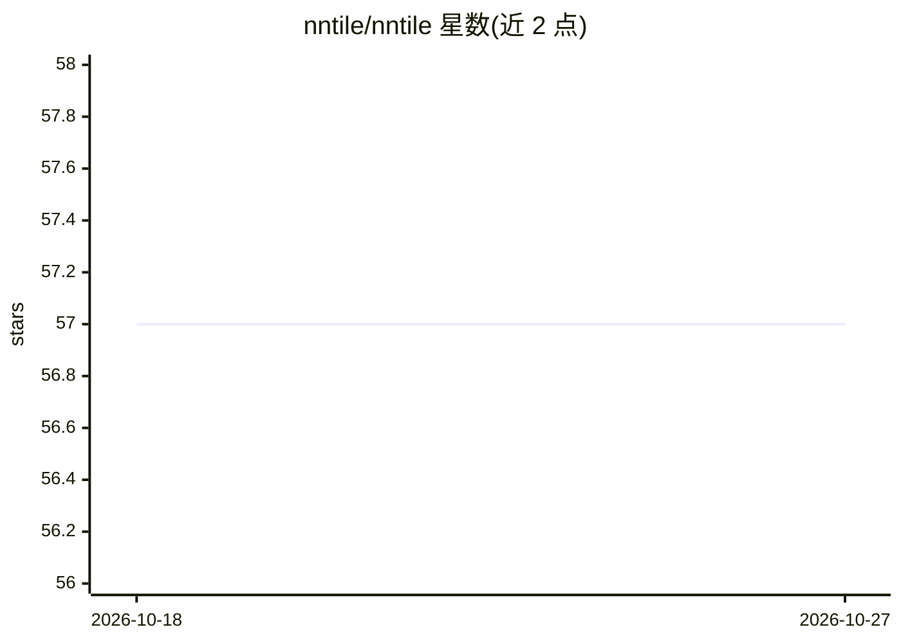

# nntile/nntile

⭐ 57 · C++ · MIT · 推送 2026-10-26 · [GitHub](https://github.com/nntile/nntile) · 组织维护

**训练大型神经网络的任务级并行框架（基于 StarPU）**

面向大神经网络训练的框架，采用任务级并行编程范式，基于 StarPU 运行时跨硬件资源动态分发计算并异步搬运数据。Python 产品以 torch_nntile pip wheel 形式提供（device=nntile 后端接入 PyTorch autograd），另有 C++ 栈、TensorGraph 执行后端与推理 HTTP 网关/Telegram bot。典型用法：单 GPU 显存不足时的 LLM 微调（SGOC 调度器做 offload 与 checkpoint）、异构 GPU 上宽层模型的并行微调、受限服务器上的多模型推理（可 offload 到内存/磁盘）。要求 CUDA 计算能力 8.0+。

## 筛选速览

| 维度 | 判定 | 备注 |
|---|---|---|
| AI 角色 | `ai-ecosystem` | LLM/agent 周边工具 |
| 许可风险 | `permissive` | MIT |
| 部署形态 | `library` | 以包/库形式分发 |
| 模型依赖 | — | README 未给出锁定关系 |
| 硬件要求 | — | 无带数字的原话,不猜 |
| 安装摩擦 | `high` | 编译与系统依赖俱全 |
| 成熟度 | — | 结构信号不足 |

## 能力要点

- 基于 StarPU 的任务级并行运行时，异步数据搬运
- torch_nntile 作为 PyTorch 后端（device=nntile，autograd 兼容）
- SGOC 调度器支持显存不足时的 offload 到内存/磁盘与 checkpoint
- CUDA 计算能力 8.0+，支持异构 GPU 并行

## 适用场景

- 单 GPU 服务器上微调显存放不下的语言模型
- 异构 GPU 服务器上并行微调宽层大模型
- 资源受限服务器上运行多模型推理

## 场景标签

`模型训练` `微调` · 领域:训练与推理

## 证据(README 行号)

> L8: **NNTile** is a framework for training large neural networks. It relies on a
> L9: task-based parallel programming paradigm that distributes computations across
> L11: the StarPU runtime.

## 星数曲线

2026-10-18 57 → 2026-10-27 57（+0）

---
*卡片 v1 · prompt 1.4 · 生成 2026-10-24 · 置信度 high · 依据 README sha `dea16af91ffc` · [字段定义](../../DATASET.md)*
