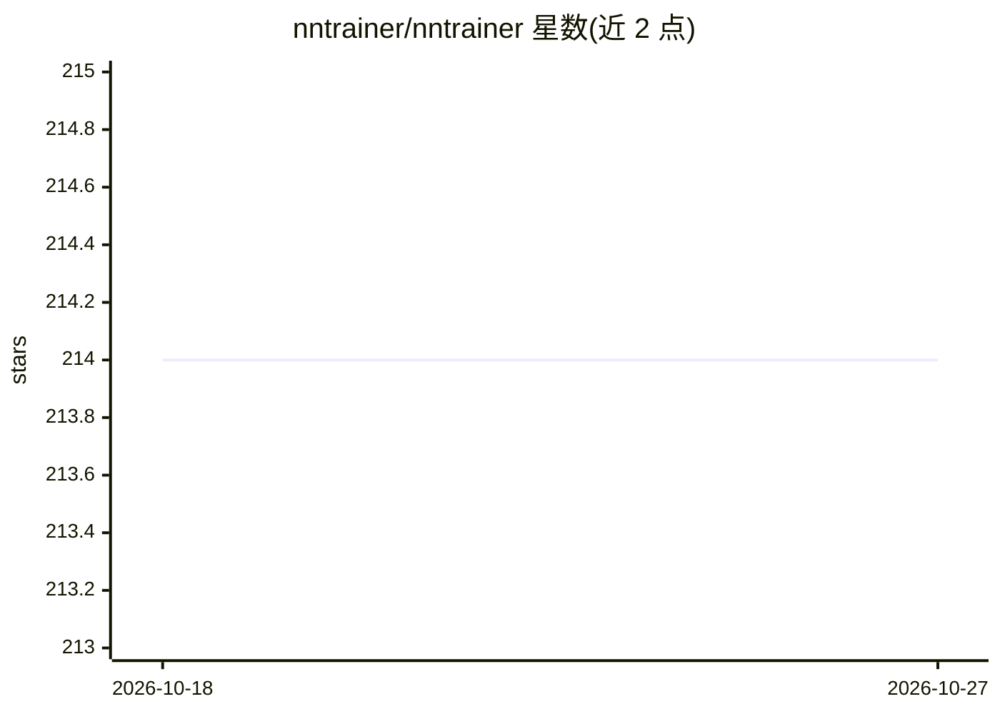

# nntrainer/nntrainer

⭐ 214 · C++ · Apache-2.0 · 推送 2026-10-19 · [GitHub](https://github.com/nntrainer/nntrainer) · 组织维护

**面向边缘设备的神经网络训练与 LLM 推理框架**

C/C++ 神经网络框架，支持在手机、Tizen、Android、Linux、Windows 等设备本地完成模型训练（迁移学习、少样本学习、全量训练、强化学习）与 LLM 推理。CausalLM 推理引擎通过 FSU（Flash Storage Utilization）从闪存按需加载 MoE 专家，将 30B 模型内存占用从 16.5GB 降至 1.3GB，支持 Qwen3、GPT-OSS、Gemma3 等模型。提供 20+ 示例应用，支持 NEON/AVX2、OpenCL、cuBLAS 与 NPU 加速，可导出 ONNX/TFLite。面向做端侧 AI 的开发者，Apache 2.0 许可。

## 筛选速览

| 维度 | 判定 | 备注 |
|---|---|---|
| AI 角色 | `ai-ecosystem` | LLM/agent 周边工具 |
| 许可风险 | `permissive` | Apache-2.0 |
| 部署形态 | `None` |  |
| 模型依赖 | — | README 未给出锁定关系 |
| 硬件要求 | — | 无带数字的原话,不猜 |
| 安装摩擦 | `low` | 无编译、无系统依赖或容器化 |
| 成熟度 | — | 结构信号不足 |

## 能力要点

- FSU 闪存按需加载专家，30B MoE 模型内存从 16.5GB 降至 1.3GB
- 端侧训练：迁移学习、少样本学习（SimpleShot）、全量 CNN/RNN/Transformer 训练、DQN 强化学习
- 支持 Qwen3/GPT-OSS/Gemma3/Qwen2 等 LLM，最高 120B 参数推理
- 跨平台 C/C++ API：Tizen、Android、Linux、Windows

## 适用场景

- 在手机上离线运行大参数 MoE LLM 推理
- 不出设备就用私有数据微调个性化模型
- 在资源受限硬件上从零训练 CNN/RNN/Transformer
- 将训练好的模型导出为 ONNX/TFLite 与其他运行时互通

## 场景标签

`微调` `推理引擎` `模型训练` · 领域:训练与推理

## 证据(README 行号)

> L3:  On-Device AI Training & LLM Inference Framework
> L69: NNTrainer was built from the ground up for **training neural networks on device** — no cloud, no data upload, no pr
> L123: - **Run Locally, Fully Offline** — Training and inference on edge devices with zero cloud dependency. Data stays o

## 星数曲线

2026-10-18 214 → 2026-10-27 214（+0）

---
*卡片 v1 · prompt 1.4 · 生成 2026-10-22 · 置信度 high · 依据 README sha `b7d09a4cb5b5` · [字段定义](../../DATASET.md)*
