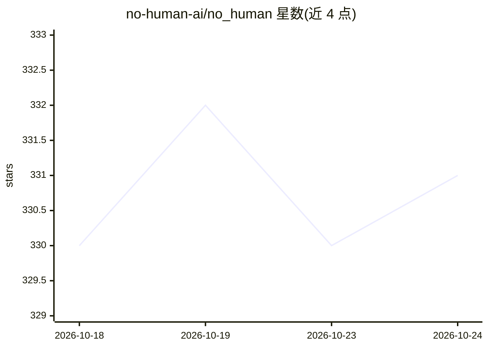

# no-human-ai/no_human

⭐ 331 · Python · MIT · 推送 2026-10-09 · [GitHub](https://github.com/no-human-ai/no_human) · [官网](https://getnohuman.com) · 组织维护 · 中文 README

**本地运行的 AI 编码工厂：从工单到经审查的拉取请求**

面向开发者的自治编码代理编排系统，在本地机器运行：从 Jira/Linear/monday.com 拉取工单，先基于工单与仓库生成计划，再由编码代理实现，随后由未见过编码会话的第二个模型做对抗式审查，辅以篡改防护（检测删除/弱化测试）、复现门（证据测试须在旧代码失败新代码通过）、测试门与诚实停止机制，最终产出带 pass/fail 清单的拉取请求。提供 CLI（uv/pipx 安装）、桌面应用与 GitHub Action 三种形态；集成 GitHub/GitLab、Slack/Teams、Jenkins/CircleCI。需 Anthropic 凭据运行，源码构建需 Python 3.12+、uv、git、Node/npm。

## 筛选速览

| 维度 | 判定 | 备注 |
|---|---|---|
| AI 角色 | `ai-ecosystem` | LLM/agent 周边工具 |
| 许可风险 | `permissive` | MIT |
| 部署形态 | `library` | 以包/库形式分发 |
| 模型依赖 | locked-api |  |
| 硬件要求 | — | 无带数字的原话,不猜 |
| 安装摩擦 | `low` | 无编译、无系统依赖或容器化 |
| 成熟度 | — | 结构信号不足 |

## 能力要点

- 独立第二模型的对抗式审查，发现须引用 file:line
- 篡改防护机械统计删除测试、新增跳过与恒真断言
- 复现门要求证据测试在 merge base 失败、新树通过
- 支持 Jira/Linear/monday.com 工单同步与 GitHub Action 单次审查

## 适用场景

- 把团队 Jira/Linear 积压工单自动实现为可审查的 PR
- 在 CI 中用对抗式审查与篡改防护把关拉取请求
- 本地并行运行多个编码任务并在看板上追踪状态

## 场景标签

`编码 Agent` `代码审查` · 领域:编码与开发

## 证据(README 行号)

> L23: - **An adversarial review.** A different model, in a session that never saw the
> L24:  coder's transcript, told to refute "done". You get a pass/fail checklist
> L133: Point no_human at the tracker you already use and it pulls the tickets to your

## 星数曲线

2026-10-18 330 → 2026-10-24 331（+1）

---
*卡片 v1 · prompt 1.4 · 生成 2026-10-21 · 置信度 mid · 依据 README sha `df633c44fcd3` · [字段定义](../../DATASET.md)*
