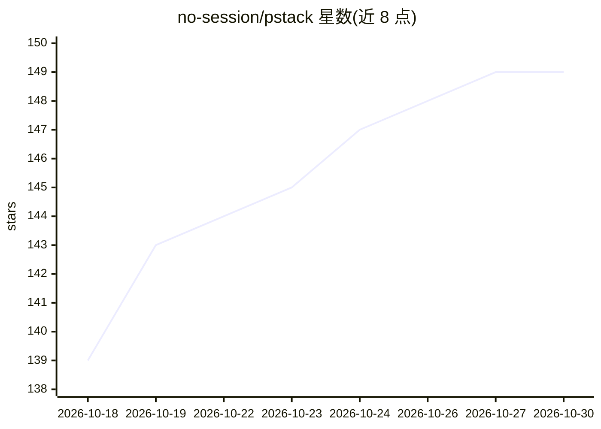

# no-session/pstack

⭐ 149 · TypeScript · MIT · 推送 2026-03-30 · [GitHub](https://github.com/no-session/pstack) · 个人维护

**面向独立开发者的 Claude Code 技能栈：验证→规划→开发→评审→上线闭环**

gstack 的分支，为单人创业者重新组织的一套 Claude Code 技能（slash 命令）集合：按 VALIDATE→PLAN→BUILD→REVIEW→SHIP→MONITOR→REFLECT 七步循环组织，覆盖需求验证、多角色计划评审、调试、代码/安全/QA/性能评审、一键部署（自动识别 Vercel/Railway/Fly 等平台）、浏览器监控与周度复盘，另含破坏性命令防护等工具。需 Claude Code、Git、Bun v1.0+，通过 git clone 到 ~/.claude/skills 并运行 setup 安装。与 gstack 的差异体现在定位单人而非团队、推送 main 即部署等工作流设定。

## 筛选速览

| 维度 | 判定 | 备注 |
|---|---|---|
| AI 角色 | `ai-ecosystem` | LLM/agent 周边工具 |
| 许可风险 | `permissive` | MIT |
| 部署形态 | `None` |  |
| 模型依赖 | locked-api |  |
| 硬件要求 | — | 无带数字的原话,不猜 |
| 安装摩擦 | `low` | 无编译、无系统依赖或容器化 |
| 成熟度 | — | 结构信号不足 |

## 能力要点

- 七步循环组织的 20+ 个 Claude Code 技能命令
- /ship 一键部署，/setup-deploy 自动识别部署平台
- /qa 在真实浏览器中测试并生成回归测试
- /cso 安全审计（OWASP Top 10、STRIDE、依赖供应链、密钥检查）

## 适用场景

- 独立开发者用 AI 完成从想法验证到部署监控的完整流程
- 单人项目缺少同事评审时用 /review /cso /qa 补齐检查环节
- 快速判断一个产品想法值不值得做（GO/KILL/PIVOT）

## 场景标签

`编码 Agent` `代码审查` · 领域:编码与开发

## 证据(README 行号)

> L136: Requirements: Claude Code, Git, Bun v1.0+
> L139: git clone --single-branch --depth 1 https://github.com/no-session/pstack.git ~/.claude/skills/pstack
> L3: **The solo founder's AI engineering stack.** Fork of gstack, rebuilt for bootstrappers, indie hackers, and solo entr

## 星数曲线

2026-10-18 139 → 2026-10-30 149（+10）

---
*卡片 v1 · prompt 1.4 · 生成 2026-10-22 · 置信度 high · 依据 README sha `dec37f15ba37` · [字段定义](../../DATASET.md)*
