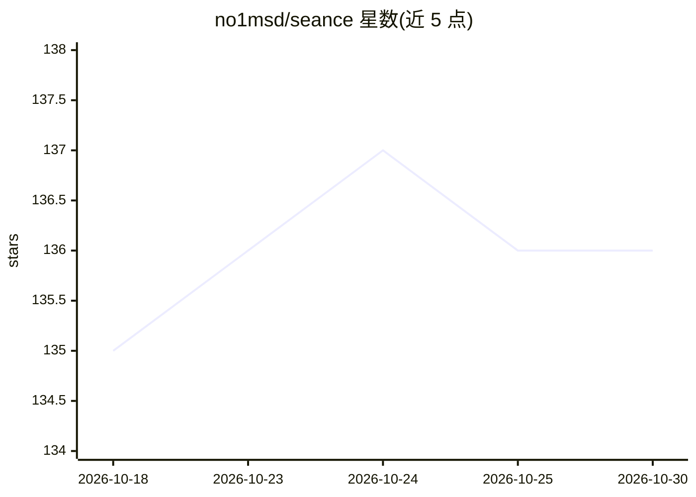

# no1msd/seance

⭐ 136 · Zig · MIT · 推送 2026-09-11 · [GitHub](https://github.com/no1msd/seance) · [官网](https://no1msd.github.io/seance) · 个人维护

**追踪 AI 编码 agent 状态的 GTK4 Linux 终端复用器**

面向 Linux 的 GTK4/libadwaita 终端复用器：面板水平滚动排布（借鉴 niri 布局模型），终端渲染使用 libghostty（Ghostty 作为库）。核心追踪能力：自动检测面板内运行的 Claude Code、Codex、Pi、OpenCode、Antigravity CLI 会话，在侧栏实时显示状态（working/waiting/idle），权限请求与任务完成转为桌面通知。`seance ctl` 经 Unix socket 暴露全部操作并支持 JSON 输出，附带供 AI agent 使用的技能文件。无追踪 agent 时仍保留普通复用器功能。安装途径含 AUR、Nix flake（编译）、AppImage 与 Zig 源码构建（需 Zig 0.16.x、GTK4、OpenGL 4.3+）。

## 筛选速览

| 维度 | 判定 | 备注 |
|---|---|---|
| AI 角色 | `ai-enhanced` | 去掉 AI 部分产品仍成立 |
| 许可风险 | `permissive` | MIT |
| 部署形态 | `desktop` | 安装包/桌面程序 |
| 模型依赖 | — | README 未给出锁定关系 |
| 硬件要求 | — | 无带数字的原话,不猜 |
| 安装摩擦 | `medium` | 含编译或系统依赖之一 |
| 成熟度 | — | 结构信号不足 |

## 能力要点

- 自动追踪 Claude Code/Codex/Pi/OpenCode/Antigravity CLI 会话状态并推桌面通知
- 面板水平滚动布局，适配长线性 agent 会话
- `seance ctl` 脚本化接口（Unix socket、JSON 输出）与内置 agent 技能文件
- GPU 加速渲染（libghostty）、X11/Wayland、无遥测

## 适用场景

- 在同一窗口里并行运行并监视多个 AI 编码 agent
- 通过通知与未读追踪及时处理 agent 的权限请求
- 用脚本或 agent 自身经 `seance ctl` 控制复用器

## 场景标签

 · 领域:开发者工具/终端

## 证据(README 行号)

> L17: Séance is a GTK4 terminal multiplexer for Linux. It auto-detects Claude Code, Codex, Pi, OpenCode, and Antigravity 
> L29: Claude Code, Codex, Pi, OpenCode, and Antigravity CLI are auto-tracked out of the box. Agents that do not expose li

## 星数曲线

2026-10-18 135 → 2026-10-30 136（+1）

---
*卡片 v1 · prompt 1.4 · 生成 2026-10-22 · 置信度 high · 依据 README sha `8eed70a7ce39` · [字段定义](../../DATASET.md)*
