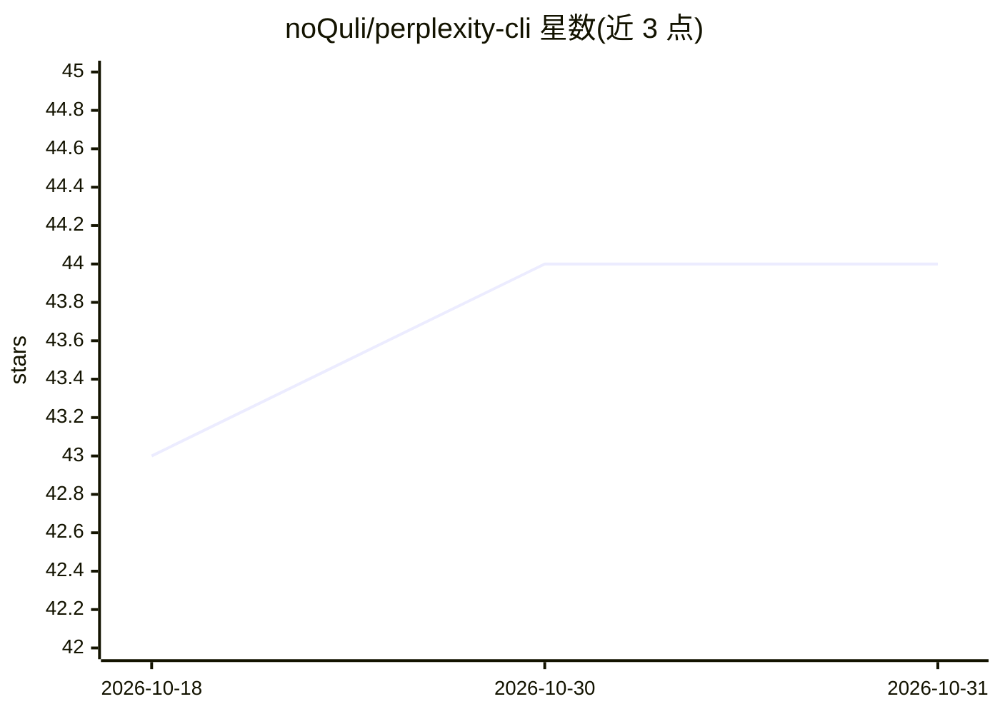

# noQuli/perplexity-cli

⭐ 44 · TypeScript · Apache-2.0 · 推送 2026-07-21 · [GitHub](https://github.com/noQuli/perplexity-cli) · 个人维护

**命令行中调用 Perplexity Sonar 模型的 AI agent 客户端**

基于 Node.js 的终端 AI agent 客户端，通过 Perplexity API 调用 sonar / sonar-pro / sonar-reasoning-pro / sonar-deep-research 四种模型，提供交互式流式对话、带引用来源的回答、实时网页搜索、内置文件系统/Shell/网页抓取工具，以及 MCP server 集成扩展自定义工具。支持非交互模式输出 JSON/stream-json 供脚本使用，含检查点保存恢复对话、PERPLEXITY.md 持久上下文与 IDE 集成。需 Node.js 20+ 与 Perplexity API key，npm 全局安装。

## 筛选速览

| 维度 | 判定 | 备注 |
|---|---|---|
| AI 角色 | `ai-native` | 本体是模型或模型工具 |
| 许可风险 | `permissive` | Apache-2.0 |
| 部署形态 | `library` | 以包/库形式分发 |
| 模型依赖 | — | README 未给出锁定关系 |
| 硬件要求 | — | 无带数字的原话,不猜 |
| 安装摩擦 | `low` | 无编译、无系统依赖或容器化 |
| 成熟度 | — | 结构信号不足 |

## 能力要点

- 调用 Perplexity Sonar 系列四种模型，回答附带引用来源
- 内置文件系统、Shell 命令、网页抓取与搜索工具
- MCP server 集成扩展自定义工具（@github/@slack 等）
- 非交互模式支持 --output-format json / stream-json 供脚本调用

## 适用场景

- 在终端里做带引用来源的实时联网研究问答
- 在脚本与自动化工作流中以 JSON 输出调用 AI 查询
- 通过 MCP 工具让 CLI 操作 GitHub、Slack 等服务

## 场景标签

`聊天机器人` `AI 助手` · 领域:对话与助手

## 证据(README 行号)

> L7: # A command-line interface for interacting with Perplexity AI's Sonar models directly from your terminal.
> L78: - **sonar-pro**: Advanced model for complex reasoning and research

## 星数曲线

2026-10-18 43 → 2026-10-31 44（+1）

---
*卡片 v1 · prompt 1.4 · 生成 2026-10-25 · 置信度 high · 依据 README sha `95a01376ced6` · [字段定义](../../DATASET.md)*
