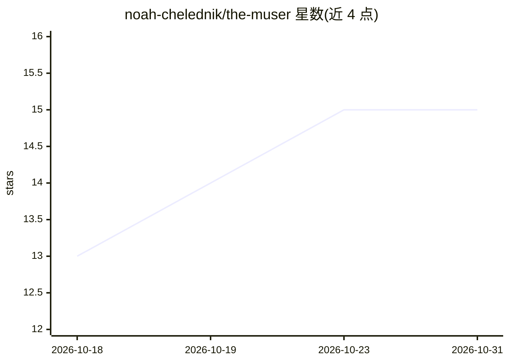

# noah-chelednik/the-muser

⭐ 15 · Python · MIT · 推送 2026-05-27 · [GitHub](https://github.com/noah-chelednik/the-muser) · [官网](https://huggingface.co/spaces/Ched-ai/the-muser) · 个人维护

**自然语言作曲的本地 AI 音乐生成工具：描述即出曲**

面向音乐创作者的本地优先 AI 作曲系统：用户以自然语言描述想要的音乐，LLM Agent（46 个工具）规划并调用多个 AI 模型生成乐谱、音频与人声——NotaGen 出古典记谱、ACE-Step 出音频、DiffSinger 唱歌、RVC 做声音转换，另含 Demucs 分离、混音效果、9 指标质量评分与音频转 MIDI。默认生成路径输出均为可商用许可。需 Python 3.10+，完整管线需 NVIDIA GPU 24GB VRAM 与 Ollama，也支持 CPU-only 的 LLM 编排模式；提供 CLI、Gradio Web UI 与 Docker 部署。

## 筛选速览

| 维度 | 判定 | 备注 |
|---|---|---|
| AI 角色 | `ai-native` | 本体是模型或模型工具 |
| 许可风险 | `permissive` | MIT |
| 部署形态 | `self-host` | docker 或自建部署 |
| 模型依赖 | local-ok | 支持本地模型 |
| 硬件要求 | `gpu-24g` | |
| 安装摩擦 | `low` | 无编译、无系统依赖或容器化 |
| 成熟度 | — | 结构信号不足 |

## 能力要点

- LLM Agent 编排 46 个工具，自然语言生成乐谱/音频/人声
- 多模型管线：NotaGen、ACE-Step、DiffSinger、RVC、Demucs
- 9 指标质量评分与 best-of-N 候选选择、12 维批次策展
- 默认输出路径全部可商用（Apache 2.0/MIT 等）

## 适用场景

- 用一句话描述生成 lo-fi、古典等风格的完整音频
- 本地离线生成音乐并保留全部输出所有权
- 从生成音频提取 MIDI/乐谱

## 场景标签

 · 领域:音乐/生成式 AI

## 证据(README 行号)

> L6: Describe what you want to hear in natural language, and The Muser orchestrates
> L7: AI models to produce scores, audio, and vocal performances — entirely on your
> L26: User ──► LLM Agent (46 tools) ──► AI Models ──► Your Music

## 星数曲线

2026-10-18 13 → 2026-10-31 15（+2）

---
*卡片 v1 · prompt 1.4 · 生成 2026-10-30 · 置信度 high · 依据 README sha `8a1b825b85bb` · [字段定义](../../DATASET.md)*
