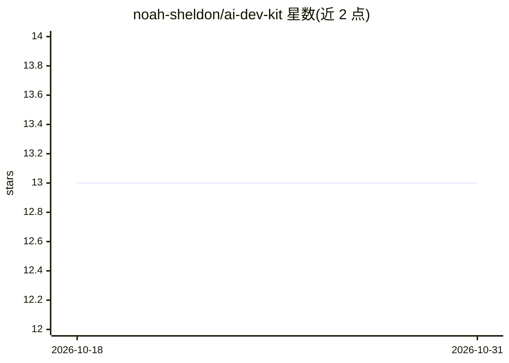

# noah-sheldon/ai-dev-kit

⭐ 13 · JavaScript · MIT · 推送 2026-04-13 · [GitHub](https://github.com/noah-sheldon/ai-dev-kit) · [官网](https://noahsheldon.dev) · 个人维护

**面向 AI 编码助手的多平台工作流脚手架：59 技能+33 agent**

插件化开发者工作区，为 Claude Code、Codex、OpenCode、Gemini CLI、Copilot CLI、Qwen Code、Cursor 等多种 AI 编码助手提供统一的工程工作流脚手架：59 个技能 playbook（TDD、安全、ML、基础设施等）、33 个领域 agent（planner、code-reviewer、ml-engineer 等）、41 个命令与生命周期 hook。工作流为 Request→Planner→Architect→Domain Agents→AI-Judge→实现→评审→合并；MCP server 不内置，由用户自配。要求 Claude Code v2.1+、Node.js 24+、Git；技能支持选择性安装。

## 筛选速览

| 维度 | 判定 | 备注 |
|---|---|---|
| AI 角色 | `ai-ecosystem` | LLM/agent 周边工具 |
| 许可风险 | `permissive` | MIT |
| 部署形态 | `library` | 以包/库形式分发 |
| 模型依赖 | locked-api |  |
| 硬件要求 | — | 无带数字的原话,不猜 |
| 安装摩擦 | `low` | 无编译、无系统依赖或容器化 |
| 成熟度 | — | 结构信号不足 |

## 能力要点

- 59 个技能 + 33 个领域 agent + 41 个命令与 hook 自动化
- 跨 7 个 AI 编码平台提供 manifest 与安装通道（含插件市场与 install.sh 手动安装）
- 定义 Planner→AI-Judge→评审→合并的标准工作流链路
- 技能自包含，支持选择性安装

## 适用场景

- 给团队常用的 AI 编码助手统一配置工程规范与评审流程
- 在 Claude Code/Codex/Gemini CLI 等工具间复用同一套 agent 与技能
- 为开发工作流引入安全评审与技术债分析 agent

## 场景标签

`Agent 框架` `代码审查` `提示工程` · 领域:Agent 开发

## 证据(README 行号)

> L13: AI Dev Kit is a **complete plugin-oriented developer workspace** for AI coding assistants. It ships everything need
> L193: ## Cross-Platform Support

## 星数曲线

2026-10-18 13 → 2026-10-31 13（+0）

---
*卡片 v1 · prompt 1.4 · 生成 2026-10-31 · 置信度 high · 依据 README sha `a42a11e0b6a3` · [字段定义](../../DATASET.md)*
