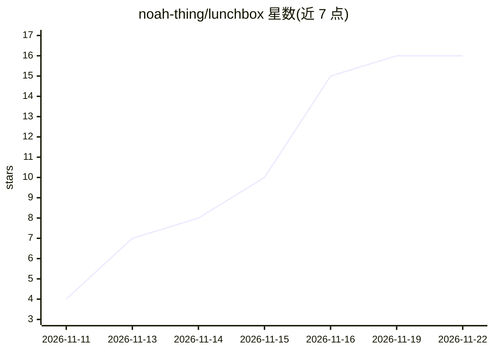

# noah-thing/lunchbox

⭐ 16 · TypeScript · 推送 2026-11-20 · [GitHub](https://github.com/noah-thing/lunchbox) · [官网](https://mylunchbox.dev) · 个人维护

**多 AI agent 共用协作的桌面工作区（Mac/Win/Linux）**

基于 Electron 的桌面应用：把 Claude Code、Codex、Grok Build、Gemini CLI 等 CLI agent 与本地模型（Ollama/LM Studio/llama.cpp）、16 家 API key 供应商聚合进同一个'房间'，各 agent 共享一段记忆、互相转交任务、接续用量额度，并在声称测试通过时核验是否有成功的运行记录。提供四档权限模式、定时 Flows、用量统计与按房间快照回滚。通过一行脚本或安装包安装，各 agent 沿用用户已有登录，数据存于本地。版本 0.1.6，版权保留未附开源许可说明。

## 筛选速览

| 维度 | 判定 | 备注 |
|---|---|---|
| AI 角色 | `ai-ecosystem` | LLM/agent 周边工具 |
| 许可风险 | `none` | — |
| 部署形态 | `library` | 以包/库形式分发 |
| 模型依赖 | local-ok | 支持本地模型 |
| 硬件要求 | — | 无带数字的原话,不猜 |
| 安装摩擦 | `low` | 无编译、无系统依赖或容器化 |
| 成熟度 | — | 结构信号不足 |

## 能力要点

- 多 vendor agent 在同一对话与同一记忆中协作，额度用尽自动交接
- 对'测试通过'等声明要求匹配的成功命令运行记录（Proof）
- Plan/Ask/Auto/Full access 四档权限模式与命令黑名单
- 支持 Ollama、LM Studio、llama.cpp 本地模型及 16 家 API key 供应商

## 适用场景

- 让 Claude Code、Codex、Grok 等多个 agent 共同完成一个开发任务
- 某个 agent 用量达限时自动由下一个接手同一任务
- 按计划定时运行测试或 SEO 检查（Flows）

## 场景标签

`多智能体` `编码 Agent` · 领域:Agent 开发

## 证据(README 行号)

> L34: Lunchbox is a shared agent room: a desktop app where AI agents from different vendors work in one conversation with
> L36: It supports Claude Code, Codex, Grok Build and Gemini CLI, OpenCode and other command line agents, local models thr

## 星数曲线

2026-11-11 4 → 2026-11-22 16（+12）

---
*卡片 v1 · prompt 1.4 · 生成 2026-11-18 · 置信度 mid · 依据 README sha `54a21c10a3dc` · [字段定义](../../DATASET.md)*
