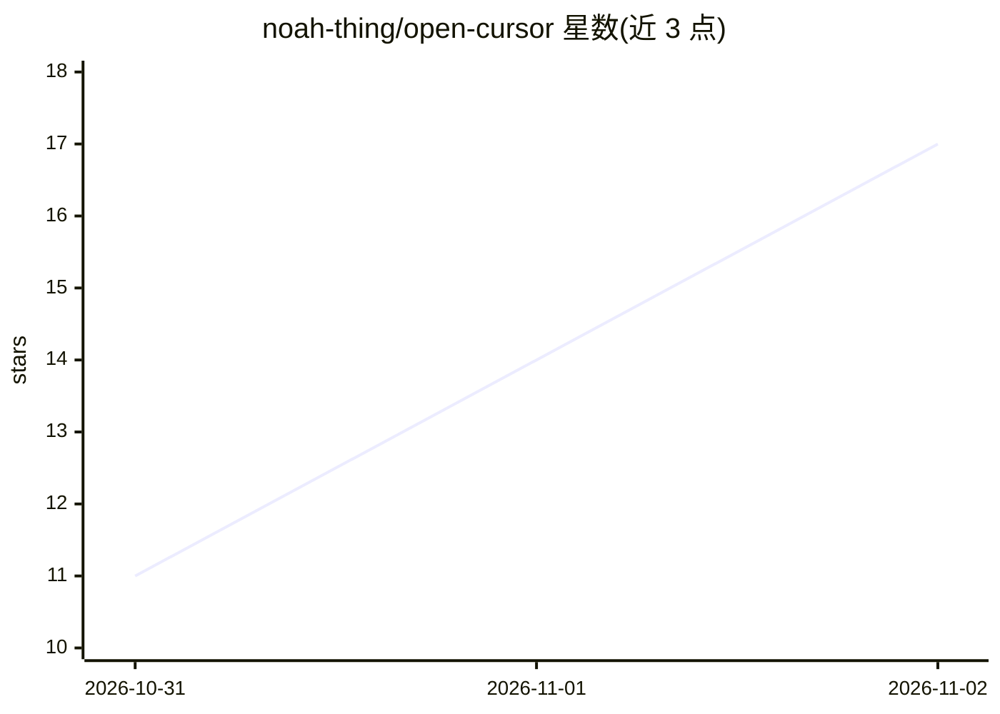

# noah-thing/open-cursor

⭐ 17 · TypeScript · MIT · 推送 2026-10-30 · [GitHub](https://github.com/noah-thing/open-cursor) · [官网](https://opencursor.org) · 个人维护

**开源 AI 代码编辑器：自带 Agent/补全，用你自己的模型与密钥**

基于 Code - OSS 的分支，内置 Agent（Agent/Plan/Debug/Ask 四模式）、Tab 多行补全、Cmd+K 内联编辑与逐块 diff 审查。界面布局与 Cursor 一致，VS Code 扩展与设置可直接使用。模型来源支持 API key（Anthropic/OpenAI/DeepSeek 等）、订阅 CLI（Claude Code/Codex 等）、本地模型（Ollama/LM Studio）及免费模型；请求从本机直达供应商，无账号与代理服务器。提供 macOS/Windows/Linux 安装包与安装脚本，构建未签名。

## 筛选速览

| 维度 | 判定 | 备注 |
|---|---|---|
| AI 角色 | `ai-ecosystem` | LLM/agent 周边工具 |
| 许可风险 | `permissive` | MIT |
| 部署形态 | `desktop` | 安装包/桌面程序 |
| 模型依赖 | local-ok | 支持本地模型 |
| 硬件要求 | — | 无带数字的原话,不猜 |
| 安装摩擦 | `low` | 无编译、无系统依赖或容器化 |
| 成熟度 | — | 结构信号不足 |

## 能力要点

- Agent 读写代码、编辑文件、执行命令，含权限分级与思考强度设置
- 支持 API key/订阅 CLI/本地模型（Ollama、LM Studio、OpenAI 兼容服务）多种模型来源
- Cmd+K 内联 diff 编辑、逐块保留/撤销的审查与消息级检查点
- 本地代码库索引驱动的语义搜索与 @ 上下文引用

## 适用场景

- 用自己的 API key 或本地模型写代码，不想为编辑器另付订阅
- 从 Cursor 迁移而保留原有操作习惯
- 在断网或隐私敏感环境下用本地模型完成补全与 Agent 任务

## 场景标签

`编码 Agent` `代码生成` · 领域:编码与开发

## 证据(README 行号)

> L26: OpenCursor is a fork of Code - OSS with an agent, Tab completion and inline editing built in. It is laid out the wa
> L28: What sets it apart is who you pay. Point it at an API key, a model running on your machine, or the Claude Code, Cod

## 星数曲线

2026-10-31 11 → 2026-11-02 17（+6）

---
*卡片 v1 · prompt 1.4 · 生成 2026-10-31 · 置信度 high · 依据 README sha `8edcf1f5d2c1` · [字段定义](../../DATASET.md)*
