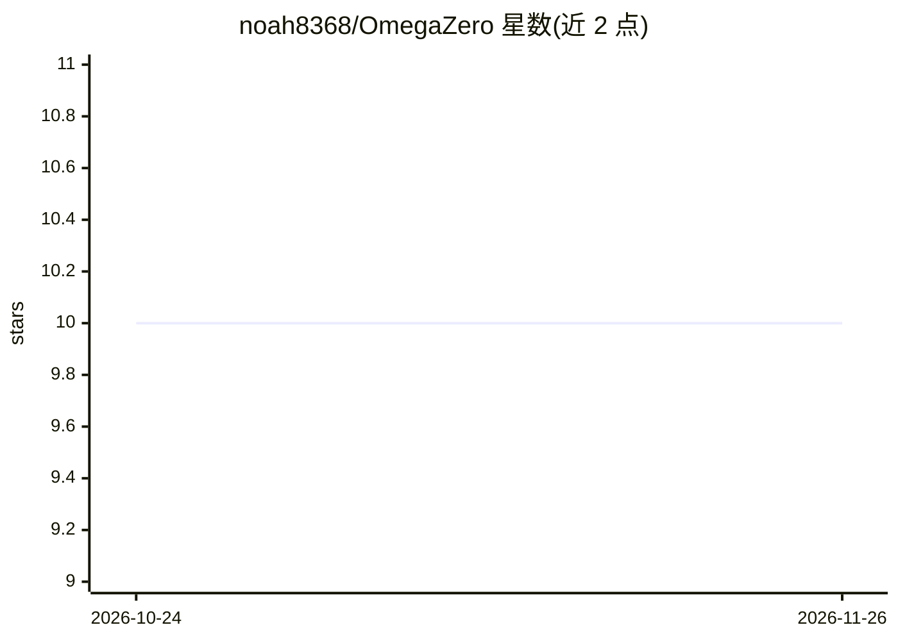

# noah8368/OmegaZero

⭐ 10 · C++ · MIT · 推送 2026-09-15 · [GitHub](https://github.com/noah8368/OmegaZero) · 个人维护

**开源国际象棋引擎，内置终端界面对弈**

OmegaZero 是一个 MIT 许可的国际象棋引擎，名字致敬 AlphaZero，内置终端界面，支持 UCI 协议，在 Lichess 以 bot 形式提供在线对弈。评估端使用 NNUE HalfKP 网络（int16/int8 量化推理），权重文件缺失时回退到启发式评估；搜索端使用 PVS、Aspiration Windows 及多种剪枝算法，配合置换表与 Lazy SMP 并行搜索。版本发布以 SPRT 检验 Elo 增益为准，README 标称约 2348 Elo。构建依赖 g++/make 与 Python 3。

## 筛选速览

| 维度 | 判定 | 备注 |
|---|---|---|
| AI 角色 | `ai-native` | 本体是模型或模型工具 |
| 许可风险 | `permissive` | MIT |
| 部署形态 | `library` | 以包/库形式分发 |
| 模型依赖 | — | README 未给出锁定关系 |
| 硬件要求 | — | 无带数字的原话,不猜 |
| 安装摩擦 | `medium` | 含编译或系统依赖之一 |
| 成熟度 | — | 结构信号不足 |

## 能力要点

- NNUE HalfKP 评估，权重缺失时回退启发式评估
- PVS 搜索配合 NMP/LMR 等多种剪枝与置换表
- Lazy SMP 多核并行搜索，无锁置换表
- 可选 Syzygy 残局表库与 PGN 开局库（2,678 局）

## 适用场景

- 在终端与引擎直接对弈
- 作为 UCI 引擎接入 Lichess 等平台对弈
- 训练 NNUE 权重或进行 Elo 测试

## 场景标签

 · 领域:游戏引擎/棋类 AI

## 证据(README 行号)

> L23: OmegaZero is a chess engine with a built-in terminal interface. The name *OmegaZero* is a nod to AlphaZero. The eng
> L91: OmegaZero primarily evaluates positions using an NNUE (Efficiently Updatable Neural Network), specifically the Half

## 星数曲线

2026-10-24 10 → 2026-11-26 10（+0）

---
*卡片 v1 · prompt 1.4 · 生成 2026-11-19 · 置信度 mid · 依据 README sha `3c04da606ef5` · [字段定义](../../DATASET.md)*
