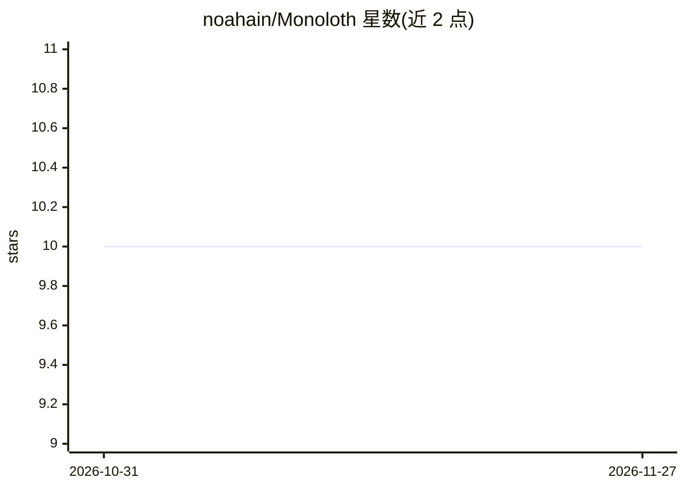

# noahain/Monoloth

⭐ 10 · JavaScript · MIT · 推送 2026-11-03 · [GitHub](https://github.com/noahain/Monoloth) · [官网](https://noahain.xyz/projects/monoloth) · 个人维护

**把 OpenCode、Claude Code 等 CLI agent 包进桌面窗口的启动器外壳**

基于 Tauri 2 + Rust 后端与无打包器的 vanilla JS 前端构建的桌面外壳，在 Windows/macOS/Linux 上以原生窗口运行 OpenCode、Claude Code 等 CLI 编码 agent。每个会话运行在 portable-pty 管理的独立 PTY 中，映射到 xterm.js WebGL 渲染的终端标签页。提供多标签工作区、命令面板、按用户隔离的配置 Profile、可重绑快捷键与会话历史留存。提供预编译安装包与自动更新（minisign 签名校验），源码构建需 Rust 1.77.2+。

## 筛选速览

| 维度 | 判定 | 备注 |
|---|---|---|
| AI 角色 | `ai-ecosystem` | LLM/agent 周边工具 |
| 许可风险 | `permissive` | MIT |
| 部署形态 | `desktop` | 安装包/桌面程序 |
| 模型依赖 | — | README 未给出锁定关系 |
| 硬件要求 | — | 无带数字的原话,不猜 |
| 安装摩擦 | `low` | 无编译、无系统依赖或容器化 |
| 成熟度 | — | 结构信号不足 |

## 能力要点

- agent-agnostic 启动器：预设 OpenCode、Claude Code、Qwen、Kimi、Codex、Pi、Gemini 或自定义命令
- 每个终端会话独立 PTY + xterm.js WebGL 渲染，生成令牌防止串写输出
- 多标签、命令面板、Profile 隔离、会话历史留存（7/30/90 天）
- 预编译二进制分发并支持 minisign 签名验证的自动更新

## 适用场景

- 在桌面窗口而非裸终端中运行 CLI 编码 agent
- 多项目并行时用标签页与会话历史管理多个 agent 会话
- 按用户/项目用 Profile 切换不同的 agent 启动命令与外观设置

## 场景标签

`编码 Agent` · 领域:编码与开发

## 证据(README 行号)

> L5:  Agent-agnostic desktop shell for CLI coding tools
> L17: Monoloth wraps CLI coding agents (like OpenCode and Claude Code) in a native desktop shell on Windows, macOS, and L
> L58: - **Agent-agnostic launcher** — presets for OpenCode, Claude Code, Qwen, Kimi, Codex, Pi, and Gemini, or enter a cu

## 星数曲线

2026-10-31 10 → 2026-11-27 10（+0）

---
*卡片 v1 · prompt 1.4 · 生成 2026-11-19 · 置信度 high · 依据 README sha `3ef9646133f2` · [字段定义](../../DATASET.md)*
