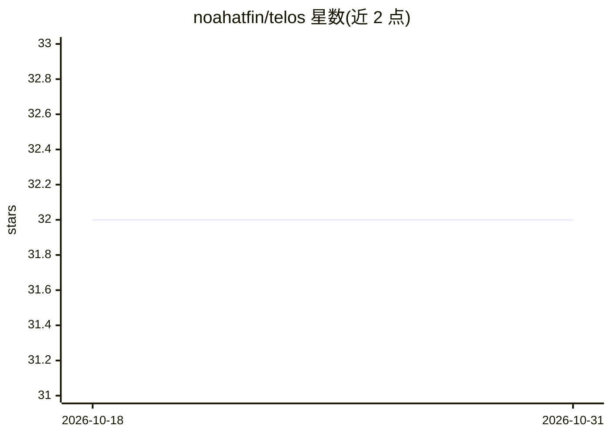

# noahatfin/telos

⭐ 32 · Rust · MIT · 推送 2026-03-02 · [GitHub](https://github.com/noahatfin/telos) · 个人维护

**面向 AI 编码 agent 的意图与约束追踪层，构建于 Git 旁**

Rust 编写的命令行工具，在 Git 仓库旁建立 .telos/ 内容寻址存储（SHA-256、不可变、DAG 结构），记录开发意图、约束、决策、代码绑定与 agent 操作。提供 CLI 命令集：创建/查询意图与约束、约束生命周期管理（supersede/deprecate）、代码绑定校验、影响分析与覆盖热力图、约束导出到 agent 记忆文件（CLAUDE.md 等）。所有读命令支持 --json 供 agent 消费。需 Rust 1.70+ 从源码编译，README 声明处于活跃开发期，API 与存储格式可能变更。

## 筛选速览

| 维度 | 判定 | 备注 |
|---|---|---|
| AI 角色 | `ai-ecosystem` | LLM/agent 周边工具 |
| 许可风险 | `permissive` | MIT |
| 部署形态 | `None` |  |
| 模型依赖 | — | README 未给出锁定关系 |
| 硬件要求 | — | 无带数字的原话,不猜 |
| 安装摩擦 | `medium` | 含编译或系统依赖之一 |
| 成熟度 | `idea` | |

## 能力要点

- 内容寻址存储（SHA-256 扇出对象库，不可变、原子写入）
- 意图/约束/决策/代码绑定/agent 操作五类结构化对象
- sync 命令将活动约束导出到 CLAUDE.md 等 agent 记忆文件
- 102 个测试覆盖 4 个 crate

## 适用场景

- AI agent 跨会话恢复项目上下文与约束记忆
- 追踪某个文件或提交受哪些约束和决策影响
- 维护带生命周期的约束并检查代码绑定有效性

## 场景标签

`Agent 记忆` · 领域:Agent 开发

## 证据(README 行号)

> L3:  Agent-first intent and constraint tracking layer for Git.
> L25: > **Telos captures intent, constraints, decisions, and code bindings in a structured, queryable, content-addressabl
> L244: Telos is built **agent-first**. Every read command supports `--json`:

## 星数曲线

2026-10-18 32 → 2026-10-31 32（+0）

---
*卡片 v1 · prompt 1.4 · 生成 2026-10-25 · 置信度 high · 依据 README sha `bbcad3ea8b11` · [字段定义](../../DATASET.md)*
