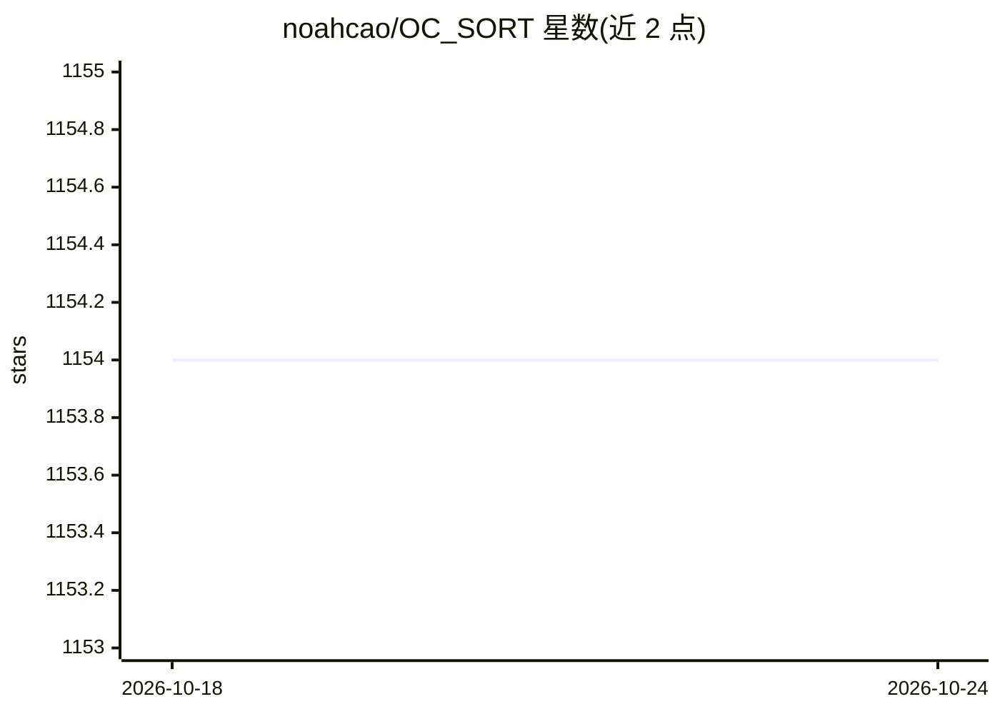

# noahcao/OC_SORT

⭐ 1,154 · Python · MIT · 推送 2026-04-21 · [GitHub](https://github.com/noahcao/OC_SORT) · 个人维护

**视频多目标跟踪器：纯运动模型，遮挡与非线性运动下保持鲁棒**

CVPR2023 论文 Observation-Centric SORT 的官方实现，基于纯运动模型的多目标跟踪器，通过修正 Kalman 滤波与 SORT 的局限提升拥挤场景和非线性运动下的跟踪鲁棒性，保持 Simple/Online/Real-time 特性。提供 Python 实现（近期重构获得约 1.5-2 倍推理加速）与 C++ 支持，可集成不同检测器与匹配模块（如外观相似度）。在 MOT17/MOT20/KITTI/DanceTrack 等数据集给出基准结果，支持 ONNX/TensorRT/ncnn 部署。安装依赖见 INSTALL.md。

## 筛选速览

| 维度 | 判定 | 备注 |
|---|---|---|
| AI 角色 | `ai-native` | 本体是模型或模型工具 |
| 许可风险 | `permissive` | MIT |
| 部署形态 | `None` |  |
| 模型依赖 | — | README 未给出锁定关系 |
| 硬件要求 | — | 无带数字的原话,不猜 |
| 安装摩擦 | `low` | 无编译、无系统依赖或容器化 |
| 成熟度 | — | 结构信号不足 |

## 能力要点

- 纯运动模型跟踪，针对遮挡与非线性运动设计（Observation-centric Re-Update）
- 提供 C++ 支持与 ONNX/TensorRT/ncnn 部署路径
- RTX 2080Ti 上约 28FPS；检测已提供时 CPU 关联速度 700FPS
- MOT17/MOT20/KITTI/DanceTrack/CroHD 基准结果与 YOLOX 预训练权重

## 适用场景

- 拥挤场景或非线性运动下的视频多目标跟踪
- 复现 CVPR2023 论文结果或做跟踪基准对比
- 通过 ONNX/TensorRT/ncnn 在部署环境运行跟踪器

## 场景标签

 · 领域:计算机视觉/多目标跟踪

## 证据(README 行号)

> L5: **Observation-Centric SORT (OC-SORT)** is a pure motion-model-based multi-object tracker. It aims to improve trackin
> L16: * [02/28/2023]: OC-SORT is accepted to CVPR 2023. We will update the code and paper soon. We made intensive revisio

## 星数曲线

2026-10-18 1,154 → 2026-10-24 1,154（+0）

---
*卡片 v1 · prompt 1.4 · 生成 2026-10-21 · 置信度 high · 依据 README sha `cf8804033f4c` · [字段定义](../../DATASET.md)*
