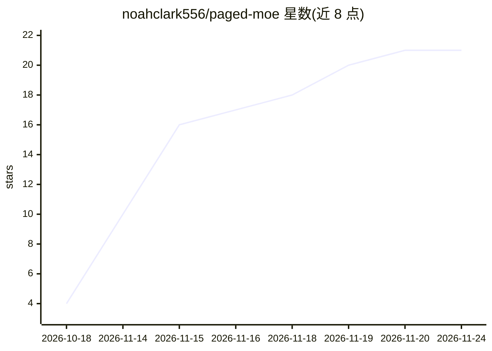

# noahclark556/paged-moe

⭐ 21 · Python · AGPL-3.0 · 推送 2026-11-18 · [GitHub](https://github.com/noahclark556/paged-moe) · 个人维护

**Apple Silicon 上按需从 SSD 流式加载 MoE 专家的推理引擎**

基于 MLX/mlx-lm 的 MoE 推理引擎：常驻骨干权重在内存中，路由专家按需从 SSD 分页读入，使总参数量超过内存的模型（如 Kimi-K2、GLM-4.7、DeepSeek-V3.2）在 48 GB MacBook 上以约 30 GB 峰值内存运行。提供 OpenAI 兼容服务端、CLI（serve/bench）与 mlx_lm.load 钩子，供本地 agent 与编码助手调用。限制：v0.3.0 预发布、仅 PyPI 外的源码安装、依赖版本锁定、仅支持 Apple Silicon 与 Python 3.10+。

## 筛选速览

| 维度 | 判定 | 备注 |
|---|---|---|
| AI 角色 | `ai-ecosystem` | LLM/agent 周边工具 |
| 许可风险 | `dual` | AGPL-3.0 |
| 部署形态 | `library` | 以包/库形式分发 |
| 模型依赖 | — | README 未给出锁定关系 |
| 硬件要求 | — | 无带数字的原话,不猜 |
| 安装摩擦 | `medium` | 含编译或系统依赖之一 |
| 成熟度 | `idea` | |

## 能力要点

- 按需从 SSD 分页加载 MoE 路由专家，常驻骨干权重
- 提供 OpenAI 兼容服务端与 mlx_lm.load 钩子，正常 mlx-lm 工作流可用
- 内置 bench 命令复现编码 agent 负载的内存/速度基准
- agent 多轮会话只预填充新增 token（0.3-2 秒开轮）

## 适用场景

- 在内存不足的 MacBook 上本地运行数百 GB 的 MoE 模型
- 为本地编码 agent 提供可承载大模型的 OpenAI 兼容推理服务
- 在不同 Mac 上复现模型内存峰值与解码速度基准

## 场景标签

`推理引擎` · 领域:训练与推理

## 证据(README 行号)

> L22: the weights. PagedMoE keeps the always-on backbone in memory and pages the
> L271: Or run the OpenAI-compatible server and point your agent at it:
> L24: checkpoints you already have (plain mlx-community safetensors), same mlx-lm

## 星数曲线

2026-10-18 4 → 2026-11-24 21（+17）

---
*卡片 v1 · prompt 1.4 · 生成 2026-11-18 · 置信度 mid · 依据 README sha `6bd120bfc26f` · [字段定义](../../DATASET.md)*
