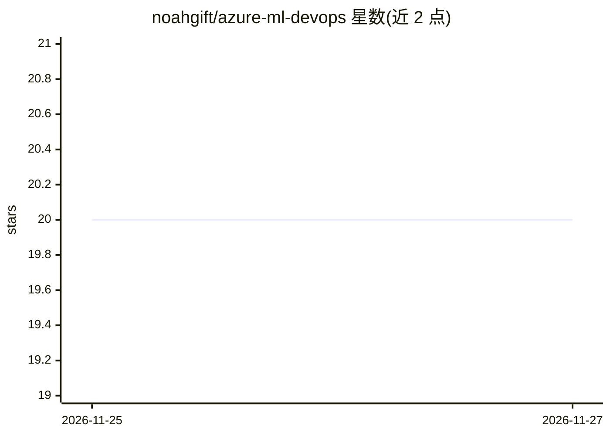

# noahgift/azure-ml-devops

⭐ 20 · Python · 推送 2026-11-23 · [GitHub](https://github.com/noahgift/azure-ml-devops) · [官网](https://www.coursera.org/learn/machine-learning-with-databricks-and-mlflow?utm_source=github&utm_medium=repo_website&utm_campaign=funnel_2026q4&utm_content=azure-ml-devops) · 个人维护

**ML 项目的 Azure DevOps 工作流脚手架教程**

面向 ML 项目的 Azure DevOps 工作流教程仓库，以步骤清单形式指导用户搭建项目脚手架：创建 Makefile 与 requirements.txt、配置 Python 虚拟环境、编写示例代码与 pytest 测试、设置 GitHub Actions 持续集成，并将容器推送到 Azure Registry、配置 Azure Pipelines 与 Kubernetes 集群完成部署。文末附带 Coursera/edX 上的 MLOps 课程链接，供系统学习。

## 筛选速览

| 维度 | 判定 | 备注 |
|---|---|---|
| AI 角色 | `ai-knowledge` | 知识聚合/清单类 |
| 许可风险 | `none` | — |
| 部署形态 | `library` | 以包/库形式分发 |
| 模型依赖 | — | README 未给出锁定关系 |
| 硬件要求 | — | 无带数字的原话,不猜 |
| 安装摩擦 | `low` | 无编译、无系统依赖或容器化 |
| 成熟度 | — | 结构信号不足 |

## 能力要点

- GitHub Actions 持续集成配置（pythonapp.yml）
- Makefile + requirements.txt 项目脚手架模板
- 容器推送 Azure Registry 并部署到 Kubernetes 的流程步骤
- 附带 Coursera/edX MLOps 课程链接

## 适用场景

- 为 Python ML 项目搭建 CI/CD 工作流
- 学习从测试到 Azure 容器部署的 MLOps 流程
- 在 Azure Cloud Shell 中初始化可测试的项目结构

## 场景标签

`教程课程` `MLOps` · 领域:学习与行业

## 证据(README 行号)

> L4: Azure DevOps workflow for ML
> L59: * Run `make all` which will install, lint and test code.
> L84: **Learn MLOps end to end:** Machine Learning with Databricks and MLflow (Coursera) · MLOps specialization, Duke (Co

## 星数曲线

2026-11-25 20 → 2026-11-27 20（+0）

---
*卡片 v1 · prompt 1.4 · 生成 2026-11-24 · 置信度 high · 依据 README sha `b83c73be7984` · [字段定义](../../DATASET.md)*
