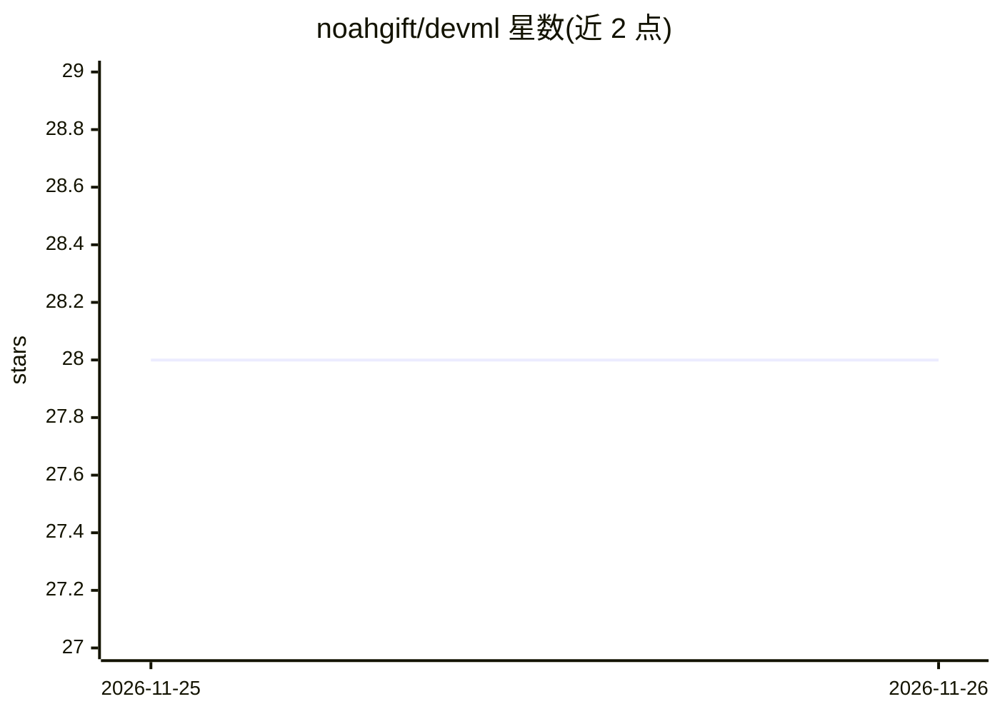

# noahgift/devml

⭐ 28 · Jupyter Notebook · MIT · 推送 2026-11-23 · [GitHub](https://github.com/noahgift/devml) · [官网](https://paiml.com/) · 个人维护

**面向开发者/团队/项目的 GitHub 仓库生产力统计与机器学习工具**

Pragmatic AI Labs 赞助的 Python 工具库与 CLI（dml），可批量 clone 一个 GitHub 组织的全部仓库，将检出后的仓库树转换为 pandas DataFrame，提供作者提交统计、活跃度统计、按文件类型的代码 churn（修改次数）统计、删除文件统计及仓库间对比。需配置 GitHub personal access token（config.json 或命令行传入），Python 3.6+，附 Jupyter notebook 示例。项目属 workplace analytics 领域，材料对应 Pragmatic AI 图书第 8 章。

## 筛选速览

| 维度 | 判定 | 备注 |
|---|---|---|
| AI 角色 | `ai-enhanced` | 去掉 AI 部分产品仍成立 |
| 许可风险 | `permissive` | MIT |
| 部署形态 | `library` | 以包/库形式分发 |
| 模型依赖 | — | README 未给出锁定关系 |
| 硬件要求 | — | 无带数字的原话,不猜 |
| 安装摩擦 | `low` | 无编译、无系统依赖或容器化 |
| 成熟度 | — | 结构信号不足 |

## 能力要点

- 批量 clone GitHub 组织全部仓库并转为 pandas DataFrame
- CLI 提供作者提交数、活跃天数/活跃比、按扩展名的 churn 统计与中位数对比
- 支持 IBM Engineering Workflow Manager (RTC) 项目区数据读取
- 提供 GitHub 数据探索与仓库文件元数据的 Jupyter notebook 示例

## 适用场景

- 统计公司 GitHub 组织中各开发者的提交与活跃度
- 按文件类型分析代码 churn 以辅助关注易缺陷模块
- 对比多个开源仓库（如 flask 与 cpython）的相对 churn 水平

## 场景标签

`数据分析` · 领域:效率与自动化

## 证据(README 行号)

> L5: Machine Learning, Statistics and Utilities around Developer Productivity
> L11: * Converts a tree of checked out repositories on disk into a pandas dataframe
> L223: Code churn is the amount of times a file has been modified. Relative churn is the amount of times it has been modi

## 星数曲线

2026-11-25 28 → 2026-11-26 28（+0）

---
*卡片 v1 · prompt 1.4 · 生成 2026-11-24 · 置信度 mid · 依据 README sha `325abbcb0b88` · [字段定义](../../DATASET.md)*
