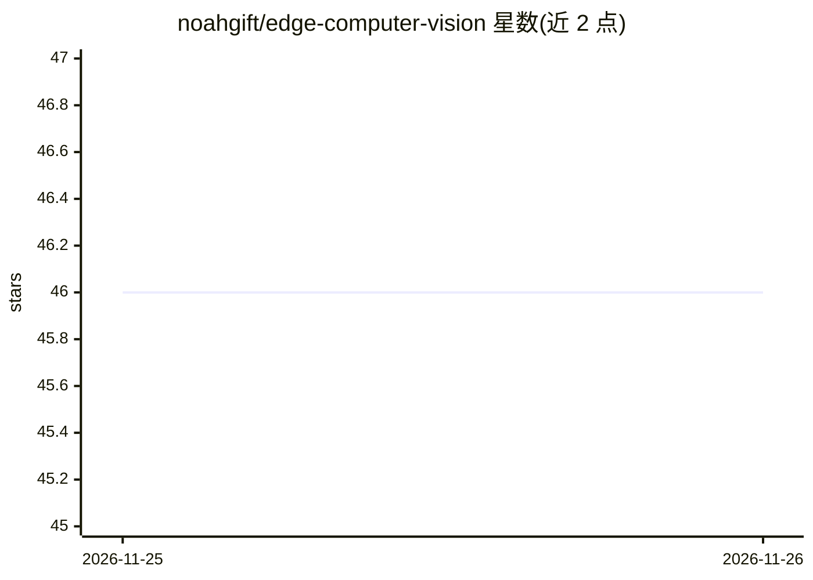

# noahgift/edge-computer-vision

⭐ 46 · Jupyter Notebook · NOASSERTION · 推送 2026-11-23 · [GitHub](https://github.com/noahgift/edge-computer-vision) · [官网](https://noahgift.github.io/edge-computer-vision/) · 个人维护

**面向学习者的边缘计算机视觉课程大纲与资源清单**

一份课程仓库，按 6 节课组织教学大纲：从应用计算机视觉导论、新兴技术、计算机视觉 API、AutoML（含 Ludwig 与 GCP AutoML 教程）到边缘端运行 CV 模型与结课演示。附带 GitHub Actions/CircleCI 构建状态，以及 GPU/CUDA、Streamlit、Apple Create ML 等扩展资源链接，并列出作者的相关书籍、视频与在线课程。适合按大纲自学的学习者与授课者。

## 筛选速览

| 维度 | 判定 | 备注 |
|---|---|---|
| AI 角色 | `ai-knowledge` | 知识聚合/清单类 |
| 许可风险 | `none` | NOASSERTION |
| 部署形态 | `None` |  |
| 模型依赖 | — | README 未给出锁定关系 |
| 硬件要求 | — | 无带数字的原话,不猜 |
| 安装摩擦 | `medium` | 含编译或系统依赖之一 |
| 成熟度 | — | 结构信号不足 |

## 能力要点

- 6 节课的课程大纲覆盖 CV API、AutoML 与边缘部署
- 包含 Ludwig 与 GCP AutoML 教程等实践内容
- 附 GitHub Actions 与 CircleCI 构建状态
- 附带 GPU/CUDA、Streamlit、Create ML 等资源链接

## 适用场景

- 按课程大纲自学应用计算机视觉与边缘部署
- 查找 AutoML 计算机视觉的入门教程材料
- 了解边缘端运行 CV 模型的技术路径

## 场景标签

`教程课程` · 领域:学习与行业

## 证据(README 行号)

> L1: # Edge Computer Vision Course
> L11: ## Lesson 1: Introduction to Applied Computer Vision

## 星数曲线

2026-11-25 46 → 2026-11-26 46（+0）

---
*卡片 v1 · prompt 1.4 · 生成 2026-11-25 · 置信度 high · 依据 README sha `11598d08e41b` · [字段定义](../../DATASET.md)*
