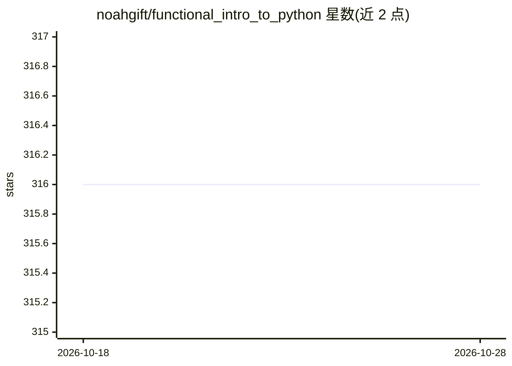

# noahgift/functional_intro_to_python

⭐ 316 · Jupyter Notebook · NOASSERTION · 推送 2026-09-01 · [GitHub](https://github.com/noahgift/functional_intro_to_python) · [官网](https://noahgift.github.io/functional_intro_to_python/) · 个人维护

**面向数据科学的 Python 函数式入门教学仓库（含 Rust 转译）**

面向零编程基础学习者的 Python 教学仓库，以 Jupyter notebook 形式提供函数式、数据科学导向的入门内容，后续章节覆盖机器学习、线性优化、命令行工具、推荐引擎、情感分析与云计算。仓库以 uv + ruff + ty 为唯一工具链，要求 100% 分支覆盖率，示例可通过 depyler 转译为 Rust 并以 clippy 与 proptest 校验。README 同时大量列出 Pragmatic AI Labs 与 Duke University 的课程 specialization 目录。

## 筛选速览

| 维度 | 判定 | 备注 |
|---|---|---|
| AI 角色 | `ai-knowledge` | 知识聚合/清单类 |
| 许可风险 | `none` | NOASSERTION |
| 部署形态 | `None` |  |
| 模型依赖 | — | README 未给出锁定关系 |
| 硬件要求 | — | 无带数字的原话,不猜 |
| 安装摩擦 | `medium` | 含编译或系统依赖之一 |
| 成熟度 | — | 结构信号不足 |

## 能力要点

- 5 课 notebook 教程，零基础可跟随学习
- uv/ruff/ty 统一工具链，CI 强制 100% 分支覆盖率与契约测试（icontract + hypothesis）
- 示例可经 depyler 转译为 Rust 并通过 clippy -D warnings 与 proptest 校验

## 适用场景

- 零基础者以数据科学视角入门 Python
- 学习函数式写法与质量工程实践（测试、契约、覆盖率）
- 了解 Python 示例转译 Rust 的工具链流程

## 场景标签

`教程课程` · 领域:学习与行业

## 证据(README 行号)

> L150: The first section is an intentionally brief, functional, data-science-centric
> L161: The notebook files live under `notebooks/`. Run them with

## 星数曲线

2026-10-18 316 → 2026-10-28 316（+0）

---
*卡片 v1 · prompt 1.4 · 生成 2026-10-21 · 置信度 high · 依据 README sha `19c00f083892` · [字段定义](../../DATASET.md)*
