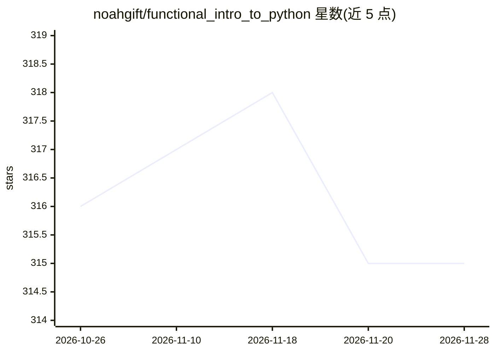

# noahgift/functional_intro_to_python

⭐ 315 · Jupyter Notebook · NOASSERTION · 推送 2026-11-23 · [GitHub](https://github.com/noahgift/functional_intro_to_python) · [官网](https://noahgift.github.io/functional_intro_to_python/) · 个人维护

**面向零基础学习者的 Python 函数式数据科学入门教程**

以 Jupyter notebook 为主体的教学仓库：第一节为面向零编程经验者的极简函数式 Python 入门，后续章节覆盖机器学习、线性优化、命令行工具、推荐系统、情感分析与云计算。课程 notebook 存放于 notebooks/ 目录，通过 make install 配置 uv 环境后以 uv run jupyter lab 运行。仓库采用 uv + ruff + ty 工具链，CI 强制 100% 分支覆盖率与契约测试，并提供示例向 Rust 转译的质检流程；README 主体为 Pragmatic AI Labs 与 Duke University 的课程专项列表。

## 筛选速览

| 维度 | 判定 | 备注 |
|---|---|---|
| AI 角色 | `ai-knowledge` | 知识聚合/清单类 |
| 许可风险 | `none` | NOASSERTION |
| 部署形态 | `None` |  |
| 模型依赖 | — | README 未给出锁定关系 |
| 硬件要求 | — | 无带数字的原话,不猜 |
| 安装摩擦 | `medium` | 含编译或系统依赖之一 |
| 成熟度 | — | 结构信号不足 |

## 能力要点

- notebooks/ 目录下的 5 课 Python 入门教程（uv run jupyter lab 运行）
- uv + ruff + ty 工具链，make install 配置环境
- 100% 分支覆盖率与 icontract/hypothesis 契约测试
- 示例可经 depyler 转译至 Rust 并通过 clippy/proptest 校验

## 适用场景

- 零编程经验者入门 Python 与数据科学
- 学习机器学习与线性优化的 notebook 实践
- 了解 uv/ruff 等现代 Python 工具链的教学示例

## 场景标签

`教程课程` · 领域:学习与行业

## 证据(README 行号)

> L148: The first section is an intentionally brief, functional, data-science-centric
> L153: The sections after that vary in difficulty and cover Machine Learning,
> L159: The notebook files live under `notebooks/`. Run them with

## 星数曲线

2026-10-26 316 → 2026-11-28 315（-1）

---
*卡片 v1 · prompt 1.4 · 生成 2026-11-25 · 置信度 high · 依据 README sha `924760651a5d` · [字段定义](../../DATASET.md)*
