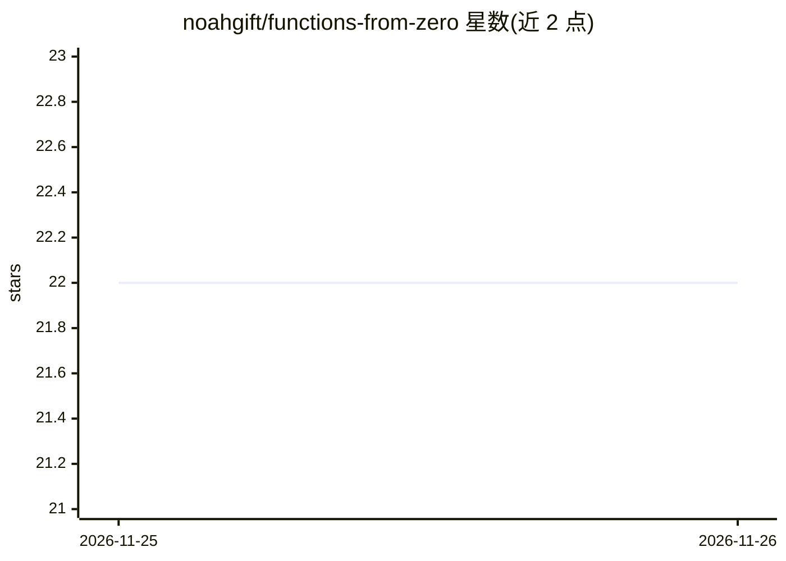

# noahgift/functions-from-zero

⭐ 22 · Jupyter Notebook · 推送 2026-11-23 · [GitHub](https://github.com/noahgift/functions-from-zero) · [官网](https://www.coursera.org/learn/ai-debugging?utm_source=github&utm_medium=repo_website&utm_campaign=funnel_2026q4&utm_content=functions-from-zero) · 个人维护

**面向学习者的 Python 微服务构建与测试培训教程**

一个 live training 教学仓库，演示如何用 Python 构建微服务并通过 GitHub Actions 做测试：包含以 curl 调用已部署微服务（/wiki 接口）的示例、使用 Docker 构建镜像与运行容器的命令，以及通过 invoke.sh 发起 POST 请求的脚本。附有 YouTube 讲解视频和 Coursera/edX 课程链接，面向学习 Python 数据与 AI 工程的学员。

## 筛选速览

| 维度 | 判定 | 备注 |
|---|---|---|
| AI 角色 | `ai-knowledge` | 知识聚合/清单类 |
| 许可风险 | `none` | — |
| 部署形态 | `self-host` | docker 或自建部署 |
| 模型依赖 | — | README 未给出锁定关系 |
| 硬件要求 | — | 无带数字的原话,不猜 |
| 安装摩擦 | `low` | 无编译、无系统依赖或容器化 |
| 成熟度 | — | 结构信号不足 |

## 能力要点

- 提供调用已部署微服务 /wiki 接口的 curl 示例
- Docker 构建与运行容器的完整命令（docker build/run）
- invoke.sh 脚本发起 POST 请求
- 附带 YouTube 讲解与 Coursera/edX 课程参考

## 适用场景

- 学习用 Docker 打包并运行 Python 微服务
- 学习用 GitHub Actions 测试 Python 应用
- 跟随 live training 课程练习数据工程技能

## 场景标签

`教程课程` · 领域:学习与行业

## 证据(README 行号)

> L2: live training
> L18: `docker build .`
> L25: `docker run -p 127.0.0.1:8080:8080 a81ce4f35866`

## 星数曲线

2026-11-25 22 → 2026-11-26 22（+0）

---
*卡片 v1 · prompt 1.4 · 生成 2026-11-24 · 置信度 high · 依据 README sha `e3072901757b` · [字段定义](../../DATASET.md)*
