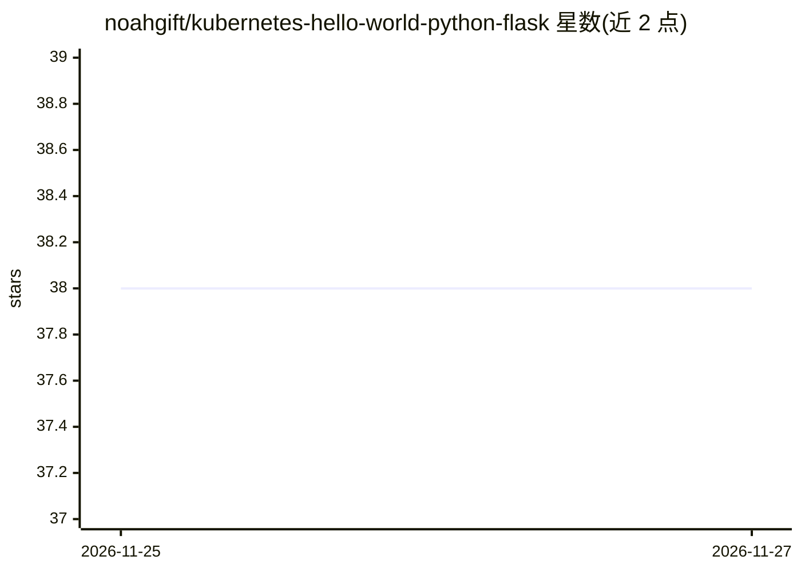

# noahgift/kubernetes-hello-world-python-flask

⭐ 38 · Python · CC0-1.0 · 推送 2026-11-23 · [GitHub](https://github.com/noahgift/kubernetes-hello-world-python-flask) · [官网](https://www.coursera.org/learn/github-zero?utm_source=github&utm_medium=repo_website&utm_campaign=funnel_2026q4&utm_content=kubernetes-hello-world-python-flask) · 个人维护

**Python Flask 应用的 Kubernetes 部署示例教程**

来自书籍 Practical MLOps 的配套示例工程：以一个返回正确找零的 Flask 应用为基础，演示容器化与 Kubernetes 部署完整流程。仓库提供 Makefile、Dockerfile、app.py 与 kube-hello-change.yaml 四个文件，通过 make all 完成依赖安装、lint 与测试，docker build/run 构建运行容器，kubectl apply 创建含负载均衡与三副本的服务。本地依赖 Docker Desktop 与 docker-desktop 的 Kubernetes 上下文。

## 筛选速览

| 维度 | 判定 | 备注 |
|---|---|---|
| AI 角色 | `ai-knowledge` | 知识聚合/清单类 |
| 许可风险 | `viral` | CC0-1.0 |
| 部署形态 | `self-host` | docker 或自建部署 |
| 模型依赖 | — | README 未给出锁定关系 |
| 硬件要求 | — | 无带数字的原话,不猜 |
| 安装摩擦 | `low` | 无编译、无系统依赖或容器化 |
| 成熟度 | — | 结构信号不足 |

## 能力要点

- 提供 Makefile 一键完成安装、lint、测试与构建（make all）
- 包含可直接 kubectl apply 的 Kubernetes YAML（负载均衡 + 三副本）
- docker build/run 全流程命令与 curl 验证示例
- Practical MLOps 书籍配套示例

## 适用场景

- 学习将 Flask 应用容器化并部署到本地 Kubernetes
- 作为 MLOps 课程/书籍的动手练习
- 复用 Makefile 与 Dockerfile 作为项目脚手架

## 场景标签

`教程课程` · 领域:学习与行业

## 证据(README 行号)

> L2: A Kubernetes Hello World Project for Python Flask. This project uses a simple Flask app that returns correct change 
> L5: This recipe is in the book Practical MLOps.

## 星数曲线

2026-11-25 38 → 2026-11-27 38（+0）

---
*卡片 v1 · prompt 1.4 · 生成 2026-11-24 · 置信度 high · 依据 README sha `f0804497b595` · [字段定义](../../DATASET.md)*
