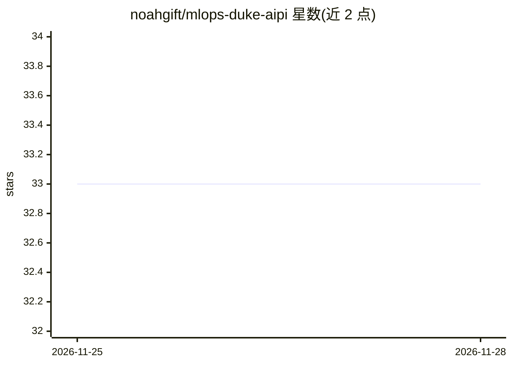

# noahgift/mlops-duke-aipi

⭐ 33 · CC0-1.0 · 推送 2026-11-23 · [GitHub](https://github.com/noahgift/mlops-duke-aipi) · [官网](https://www.coursera.org/learn/machine-learning-with-databricks-and-mlflow?utm_source=github&utm_medium=repo_website&utm_campaign=funnel_2026q4&utm_content=mlops-duke-aipi) · 组织维护

**杜克大学 MLOps 硕士课程大纲与周计划**

杜克大学 AI 产品创新工程硕士 AIPI 561 课程（Operationalizing AI / MLOps）的教学大纲：列出 2023 年 5-8 月的逐周课程安排，内容覆盖云计算基础、Python 开发环境、MLOps 基础、MLflow 与 Hugging Face 平台、SageMaker 与 Azure ML、微服务与持续交付等；附两份个人项目（GitHub Actions CLI 预测工具、AutoML 方案）与小组微服务终项的说明、参考资源清单、评分构成（讨论 40%、个人项目 40%、团队项目 20%）与迟交政策。

## 筛选速览

| 维度 | 判定 | 备注 |
|---|---|---|
| AI 角色 | `ai-knowledge` | 知识聚合/清单类 |
| 许可风险 | `viral` | CC0-1.0 |
| 部署形态 | `None` |  |
| 模型依赖 | — | README 未给出锁定关系 |
| 硬件要求 | — | 无带数字的原话,不猜 |
| 安装摩擦 | `low` | 无编译、无系统依赖或容器化 |
| 成熟度 | — | 结构信号不足 |

## 能力要点

- 13 周逐周课程安排，覆盖云平台、MLOps 基础与微服务
- 3 个项目说明：GitHub Actions CLI、AutoML、微服务 ML 端点
- 列有 MLflow、Hugging Face、SageMaker、Azure ML、Databricks 等课程内容
- 完整评分构成与成绩等级对照表

## 适用场景

- 了解这门 MLOps 课程每周学什么、做什么项目
- 评估课程 prerequisites 与考核方式后再选课
- 自学 MLOps 时参考其逐周资源清单

## 场景标签

`教程课程` · 领域:学习与行业

## 证据(README 行号)

> L4: * Syllabus for Artificial Intelligence for Product Innovation Master of Engineering: https://ai.meng.duke.edu/degree
> L10: In this course, you will learn about the methodologies involved in Machine Learning Engineering and MLOps. By the e
> L36: ## Syllabus

## 星数曲线

2026-11-25 33 → 2026-11-28 33（+0）

---
*卡片 v1 · prompt 1.4 · 生成 2026-11-24 · 置信度 high · 依据 README sha `aaff957db642` · [字段定义](../../DATASET.md)*
