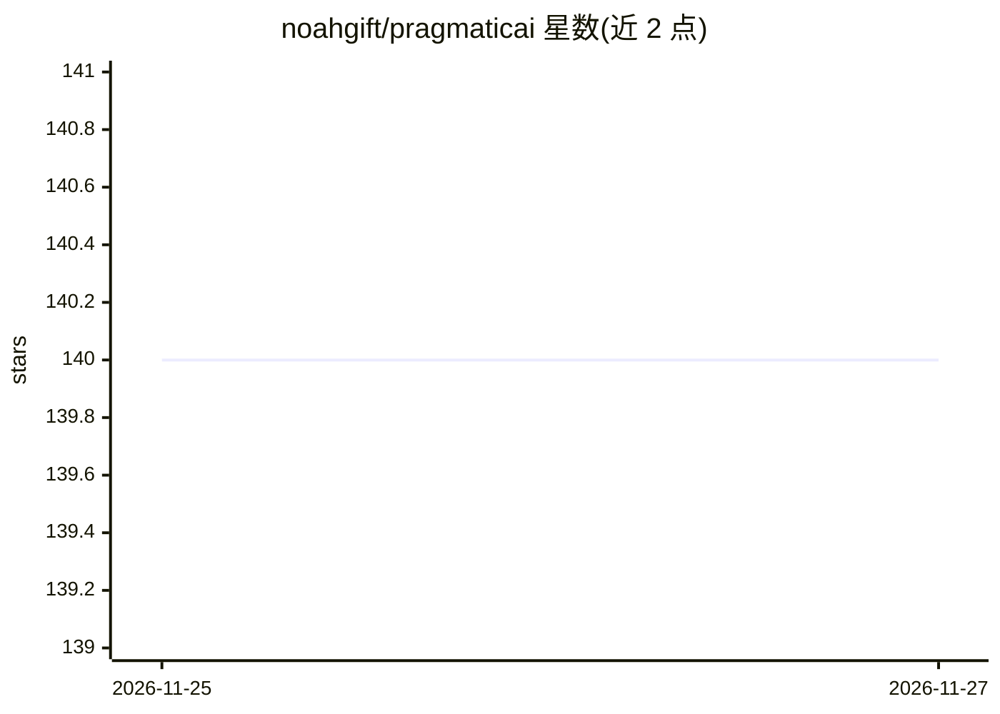

# noahgift/pragmaticai

⭐ 140 · Makefile · NOASSERTION · 推送 2026-11-23 · [GitHub](https://github.com/noahgift/pragmaticai) · [官网](http://www.informit.com/store/pragmatic-ai-an-introduction-to-cloud-based-machine-9780134863863) · 个人维护

**面向非专业数据科学家的云上机器学习图书配套 Notebook 合集**

Noah Gift 所著《Pragmatic AI: An Introduction to Cloud-based Machine Learning》一书的资源仓库，提供 11 个章节的 Jupyter Notebook 代码（涵盖 Google Cloud Platform、AWS 上的 AI 开发、Slack 机器人、EC2 实例优化、房产价格预测等）。内容面向业务专业人士、决策者和非职业数据科学家的学生，配合 Safari 视频课程与 Coursera/Duke 专项课程使用。代码采用 MIT 许可，Notebook 文本内容采用 CC-BY-NC-ND 许可。

## 筛选速览

| 维度 | 判定 | 备注 |
|---|---|---|
| AI 角色 | `ai-knowledge` | 知识聚合/清单类 |
| 许可风险 | `none` | NOASSERTION |
| 部署形态 | `None` |  |
| 模型依赖 | — | README 未给出锁定关系 |
| 硬件要求 | — | 无带数字的原话,不猜 |
| 安装摩擦 | `low` | 无编译、无系统依赖或容器化 |
| 成熟度 | — | 结构信号不足 |

## 能力要点

- 11 章图书配套 Jupyter Notebook
- 覆盖 GCP 与 AWS 的云上 AI 开发内容
- 代码 MIT 许可、文本 CC-BY-NC-ND 许可
- 配套 Coursera/Duke 课程与 Safari 视频系列

## 适用场景

- 跟随图书章节运行云上机器学习示例代码
- 学习 AWS/GCP 上的 AI 服务与部署流程
- 配合作者的课程体系学习云计算与 MLOps

## 场景标签

`教程课程` · 领域:学习与行业

## 证据(README 行号)

> L3: # Pragmatic AI: An Introduction To Cloud-based Machine Learning
> L77: ## Book Chapter Juypter Notebooks
> L94: This code is released under the MIT license

## 星数曲线

2026-11-25 140 → 2026-11-27 140（+0）

---
*卡片 v1 · prompt 1.4 · 生成 2026-11-24 · 置信度 high · 依据 README sha `97ee70723978` · [字段定义](../../DATASET.md)*
