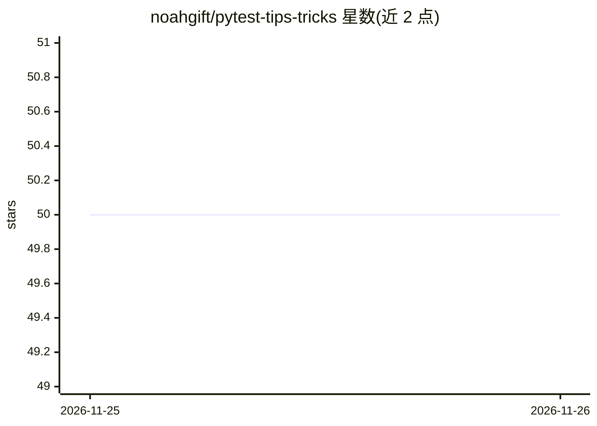

# noahgift/pytest-tips-tricks

⭐ 50 · Python · CC0-1.0 · 推送 2026-11-23 · [GitHub](https://github.com/noahgift/pytest-tips-tricks) · [官网](https://www.coursera.org/learn/ai-debugging?utm_source=github&utm_medium=repo_website&utm_campaign=funnel_2026q4&utm_content=pytest-tips-tricks) · 个人维护

**面向 Python 开发者的 pytest 测试入门教程**

一个 pytest 教程型仓库，内容为 pytest 用法清单：包括测试的必要性说明、pytest 调用方式（make test、pytest-cov 覆盖率、nbval 测试 Jupyter Notebook、--pdb 调试、失败中断与测试选择）、以及进阶主题（setup/teardown、Click CLI/Flask/FastAPI 测试）。配套 GitHub Actions 与 AWS CodeBuild 的 CI 配置说明，并提供 GitHub Codespaces、AWS Cloud9、Cloudshell 三种云开发环境搭建路径。适合学习 Python 测试的开发者与数据/机器学习工程学习者。

## 筛选速览

| 维度 | 判定 | 备注 |
|---|---|---|
| AI 角色 | `ai-knowledge` | 知识聚合/清单类 |
| 许可风险 | `viral` | CC0-1.0 |
| 部署形态 | `library` | 以包/库形式分发 |
| 模型依赖 | — | README 未给出锁定关系 |
| 硬件要求 | — | 无带数字的原话,不猜 |
| 安装摩擦 | `low` | 无编译、无系统依赖或容器化 |
| 成熟度 | — | 结构信号不足 |

## 能力要点

- pytest 调用方式清单：覆盖率、nbval、--pdb、失败中断、测试选择
- GitHub Actions 与 AWS CodeBuild 上运行 pytest 的 CI 说明
- 进阶主题：setup/teardown 与 Click/Flask/FastAPI 测试
- GitHub Codespaces / AWS Cloud9 / Cloudshell 云开发环境搭建

## 适用场景

- 学习 pytest 的基础用法与高级技巧
- 为 Python 项目配置 GitHub Actions 持续集成测试
- 在云开发环境中搭建带本地 CI 的 Python 测试工作流

## 场景标签

`教程课程` · 领域:学习与行业

## 证据(README 行号)

> L5: A primer on pytest
> L16: * CI Systems with PyTest

## 星数曲线

2026-11-25 50 → 2026-11-26 50（+0）

---
*卡片 v1 · prompt 1.4 · 生成 2026-11-24 · 置信度 mid · 依据 README sha `fcb2c95414ab` · [字段定义](../../DATASET.md)*
