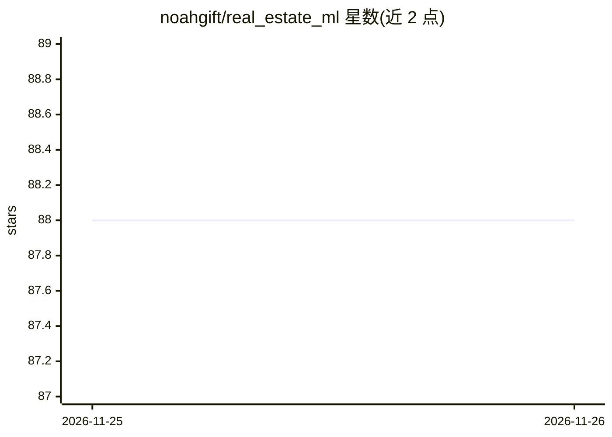

# noahgift/real_estate_ml

⭐ 88 · Jupyter Notebook · 推送 2026-11-23 · [GitHub](https://github.com/noahgift/real_estate_ml) · [官网](https://www.coursera.org/learn/ai-debugging?utm_source=github&utm_medium=repo_website&utm_campaign=funnel_2026q4&utm_content=real_estate_ml) · 个人维护

**房地产数据分析的机器学习 Jupyter 教程示例**

围绕美国房地产（Zillow）数据的机器学习示例项目，提供 Jupyter Notebook 形式的探索性数据分析内容，集成 Plotly 交互图表（如美国房地产 30 年历史、湾区独栋房价中位数），并给出 Zillow API 注册与数据下载指引。README 同时附有作者的其他 Python 数据/AI 工程课程链接，适合作为学习数据分析流程的参考材料。

## 筛选速览

| 维度 | 判定 | 备注 |
|---|---|---|
| AI 角色 | `ai-knowledge` | 知识聚合/清单类 |
| 许可风险 | `none` | — |
| 部署形态 | `None` |  |
| 模型依赖 | — | README 未给出锁定关系 |
| 硬件要求 | — | 无带数字的原话,不猜 |
| 安装摩擦 | `low` | 无编译、无系统依赖或容器化 |
| 成熟度 | — | 结构信号不足 |

## 能力要点

- Jupyter Notebook 形式的 Zillow 房地产数据探索
- Plotly 交互图表（30 年历史房价、湾区中位价）
- 提供 Zillow API 注册与数据下载指引

## 适用场景

- 学习用 Jupyter 做房地产数据探索性分析
- 参考 Plotly 交互式时间序列图表的实现
- 获取 Zillow 研究数据并做机器学习练习

## 场景标签

`教程课程` · 领域:学习与行业

## 证据(README 行号)

> L2: Machine Learning for Real Estate
> L22: * Jupyter Notebook with Plotly Integration doing Zillow Data Exploration

## 星数曲线

2026-11-25 88 → 2026-11-26 88（+0）

---
*卡片 v1 · prompt 1.4 · 生成 2026-11-24 · 置信度 mid · 依据 README sha `67a199b200d5` · [字段定义](../../DATASET.md)*
