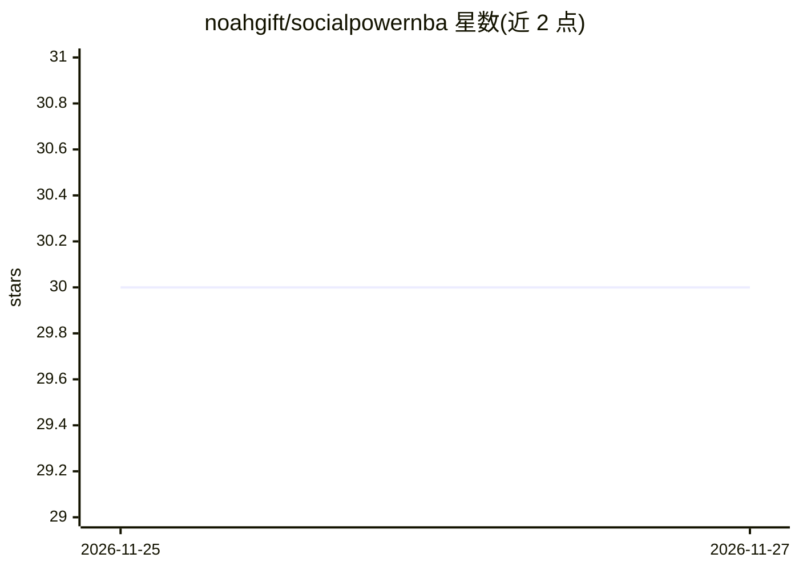

# noahgift/socialpowernba

⭐ 30 · Jupyter Notebook · NOASSERTION · 推送 2026-11-23 · [GitHub](https://github.com/noahgift/socialpowernba) · [官网](https://www.amazon.com/Pragmatic-AI-Introduction-Cloud-based-Learning/dp/0134863860) · 个人维护

**NBA 社交影响力与赛场表现的数据分析 notebook 集**

配套《Pragmatic AI》第 6 章的教学项目，用 Jupyter/IPython Notebook 与 R 分析 NBA 球队的社交媒体、薪资、影响力、表现与球队估值的关系。提供球队估值与球员两套数据集的字段说明（含 KMeans 聚类、ELO 评分等），并给出相关热图、3D 可视化等探索内容；另附 Strata 演讲、IBM 文章与 Kaggle Kernel 链接。README 未给出安装或运行命令。

## 筛选速览

| 维度 | 判定 | 备注 |
|---|---|---|
| AI 角色 | `ai-knowledge` | 知识聚合/清单类 |
| 许可风险 | `none` | NOASSERTION |
| 部署形态 | `None` |  |
| 模型依赖 | — | README 未给出锁定关系 |
| 硬件要求 | — | 无带数字的原话,不猜 |
| 安装摩擦 | `low` | 无编译、无系统依赖或容器化 |
| 成熟度 | — | 结构信号不足 |

## 能力要点

- 球队估值与球员影响力两套数据集及字段说明
- KMeans 聚类、ELO、PIE 等指标的探索性分析 notebook
- 配套 Kaggle Kernel 可在线查看
- 数据来源含 ESPN、Basketball-Reference、Twitter、Wikipedia、Forbes

## 适用场景

- 学习用 Python/R 做体育数据的探索性分析
- 研究社交媒体影响力与球员薪资表现的关系
- 获取 NBA 2016-2017 赛季的示例数据字段设计

## 场景标签

`数据分析` `教程课程` · 领域:效率与自动化

## 证据(README 行号)

> L3: This project and the data explores the relationship between Social Media, Salary, Influence, Performance and Team Va
> L88: ## Player Impact Estimation
> L116: ## Explore Juypter Notebooks

## 星数曲线

2026-11-25 30 → 2026-11-27 30（+0）

---
*卡片 v1 · prompt 1.4 · 生成 2026-11-24 · 置信度 high · 依据 README sha `9936e4931468` · [字段定义](../../DATASET.md)*
