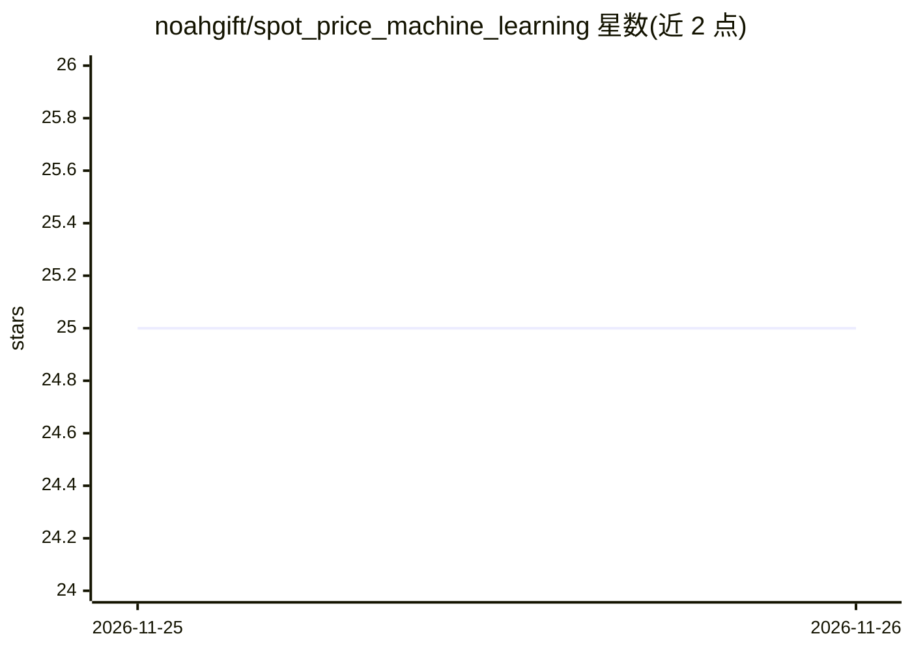

# noahgift/spot_price_machine_learning

⭐ 25 · Jupyter Notebook · MIT · 推送 2026-11-23 · [GitHub](https://github.com/noahgift/spot_price_machine_learning) · [官网](https://www.amazon.com/Pragmatic-AI-Introduction-Cloud-based-Learning/dp/0134863860) · 个人维护

**AWS Spot 价格机器学习 CLI 与 Jupyter 工具**

面向 AWS Spot 实例价格分析的命令行工具与 Jupyter Notebook，配套书籍 Pragmatic AI 第 9 章内容。包含 Spot Price ML 与 Spot Price Launcher 两个 CLI：前者按中位价格历史与每 ECU 价格描述实例类型，用机器学习（scikit-learn，主题标签含 KNN）给出替代实例推荐并绘制 Seaborn 图表；后者启动可自终止的 Spot 请求（支持指定时长）。运行需要配置 AWS 账户凭证 profile。通过 make setup/install 安装，make test 运行 Jupyter notebook 测试。

## 筛选速览

| 维度 | 判定 | 备注 |
|---|---|---|
| AI 角色 | `ai-native` | 本体是模型或模型工具 |
| 许可风险 | `permissive` | MIT |
| 部署形态 | `None` |  |
| 模型依赖 | — | README 未给出锁定关系 |
| 硬件要求 | — | 无带数字的原话,不猜 |
| 安装摩擦 | `medium` | 含编译或系统依赖之一 |
| 成熟度 | — | 结构信号不足 |

## 能力要点

- 按中位价格历史与 price per ECU 描述 Spot 实例类型
- 机器学习推荐替代 Spot 实例（recommend 命令）
- 启动指定时长后自终止的 Spot 请求（spot_launcher）
- 附带 Jupyter Notebook 版本与 Seaborn 图表

## 适用场景

- 按价格历史与 ECU 单价挑选合适的 Spot 实例类型
- 为常用 Spot 实例寻找机器学习推荐的替代机型
- 启动限时自终止的 Spot 实例控制成本

## 场景标签

`数据分析` · 领域:效率与自动化

## 证据(README 行号)

> L5: Machine Learning for Spot Prices Command-Line Tool and Jupyter Notebook. This material is covered in Chapter 9 of Pr

## 星数曲线

2026-11-25 25 → 2026-11-26 25（+0）

---
*卡片 v1 · prompt 1.4 · 生成 2026-11-24 · 置信度 high · 依据 README sha `bce7989fbace` · [字段定义](../../DATASET.md)*
