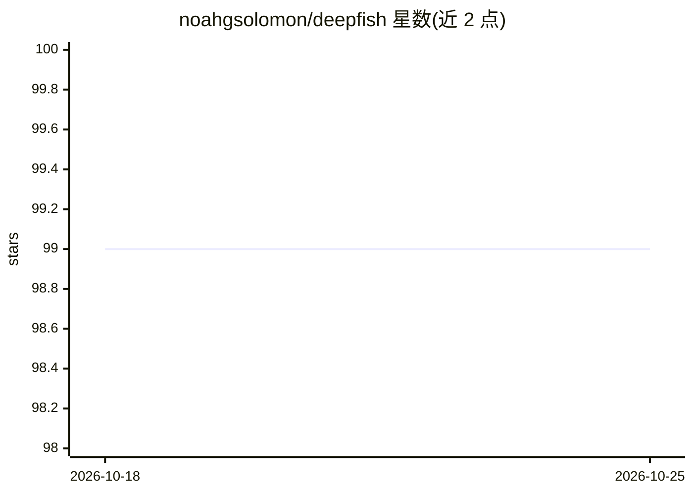

# noahgsolomon/deepfish

⭐ 99 · TypeScript · MIT · 推送 2025-11-23 · [GitHub](https://github.com/noahgsolomon/deepfish) · [官网](https://deepfi.sh) · 个人维护

**面向用户的可视化 AI 工作流编排平台，接入 Fal.ai 与 Replicate**

基于 Next.js 15 的可视化节点编辑器平台，用户通过拖拽节点将 Fal.ai 与 Replicate 上的生成模型组合为工作流，支持文本、图像、音频、视频与 3D 生成，并提供工作流导入、分享、fork 及积分计费（Stripe）功能。执行采用客户端导向的图执行与 Inngest 异步队列处理长任务。本地部署需 Node.js 18+、Docker 本地数据库，以及 Clerk、Stripe、Fal.ai、Replicate 等服务的自有 API key。采用 MIT 许可。

## 筛选速览

| 维度 | 判定 | 备注 |
|---|---|---|
| AI 角色 | `ai-ecosystem` | LLM/agent 周边工具 |
| 许可风险 | `permissive` | MIT |
| 部署形态 | `self-host` | docker 或自建部署 |
| 模型依赖 | — | README 未给出锁定关系 |
| 硬件要求 | — | 无带数字的原话,不猜 |
| 安装摩擦 | `low` | 无编译、无系统依赖或容器化 |
| 成熟度 | — | 结构信号不足 |

## 能力要点

- 拖拽式节点编辑器构建 AI 生成流水线
- Fal.ai 与 Replicate 模型的一等支持
- 多模态：文本/图像/音频/视频/3D 生成
- 工作流库支持导入、分享与 fork

## 适用场景

- 不写代码就能把多个生成模型串成流水线
- 社区分享与复用 AI 工作流
- 搭建带计费的生成式 AI 应用平台

## 场景标签

`工作流自动化` `图像生成` · 领域:效率与自动化

## 证据(README 行号)

> L8: powerful generative AI models. It allows users to combine models from providers
> L14: - **Visual Composer**: Drag-and-drop node editor to build complex AI pipelines.
> L16: - **Model Integrations**: First-class support for Fal.ai and Replicate models.

## 星数曲线

2026-10-18 99 → 2026-10-25 99（+0）

---
*卡片 v1 · prompt 1.4 · 生成 2026-10-23 · 置信度 high · 依据 README sha `f6a1309769a4` · [字段定义](../../DATASET.md)*
