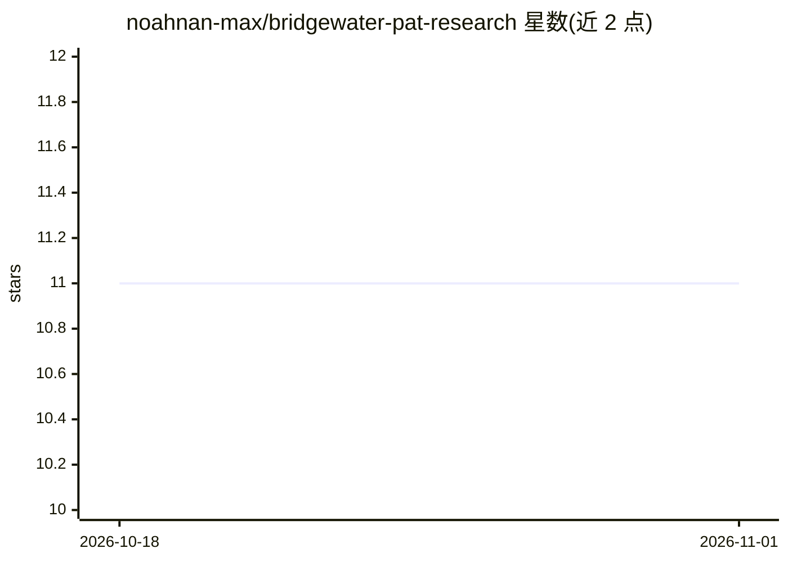

# noahnan-max/bridgewater-pat-research

⭐ 11 · Python · MIT · 推送 2026-07-31 · [GitHub](https://github.com/noahnan-max/bridgewater-pat-research) · 个人维护 · 中文 README

**面向投资研究的编译式 AI Skill：权限受限、可审计**

受 Bridgewater Pocket Analyst Tool 公开演讲启发的独立研究项目：将模糊研究问题编译为版本化请求、带类型的 DataFrame DAG 与任务级代码生成，验证在模型之外执行且不可被生成代码跳过；未列入能力清单的数据、字段与工具无法进入计划。提供五个版本化契约（请求/计划/任务结果/研究包/教学案例）与七类校验，含内容寻址增量复用与 Teach 回归循环。明确声明仅限研究调查，非投资建议，不证明真实数据访问或生产沙箱。以 git clone 源码方式运行自检脚本。

## 筛选速览

| 维度 | 判定 | 备注 |
|---|---|---|
| AI 角色 | `ai-ecosystem` | LLM/agent 周边工具 |
| 许可风险 | `permissive` | MIT |
| 部署形态 | `None` |  |
| 模型依赖 | — | README 未给出锁定关系 |
| 硬件要求 | — | 无带数字的原话,不猜 |
| 安装摩擦 | `low` | 无编译、无系统依赖或容器化 |
| 成熟度 | — | 结构信号不足 |

## 能力要点

- 五个版本化契约（research-request/analysis-plan/task-result/research-package/teach-case）
- 编译器式 DAG：环、孤儿节点、未声明字段等故障即失败关闭
- 确定性验证在模型之外运行，失败的必需检查无法达到 RESEARCH_READY
- 交易、组合、券商等语义被明确拒绝的研究专用边界

## 适用场景

- 为投资调查 agent 构建权限受限、可审计的分析流水线
- 需要每个结论可回溯到表、图表、诊断或来源的研究工作流
- 研究机构验证 agent 生成代码的类型与数据契约

## 场景标签

`金融量化` `代码生成` · 领域:编码与开发

## 证据(README 行号)

> L9: A compiler-style AI Skill for permission-bound, typed, diagnosable investment investigation.
> L11: It turns an ambiguous research question into a versioned request, a typed DataFrame DAG, task-scoped code generatio
> L32: The Chat Agent owns research intent and presentation. The Coding Agent receives exactly one compiled transformation

## 星数曲线

2026-10-18 11 → 2026-11-01 11（+0）

---
*卡片 v1 · prompt 1.4 · 生成 2026-11-01 · 置信度 mid · 依据 README sha `e99d00129fba` · [字段定义](../../DATASET.md)*
