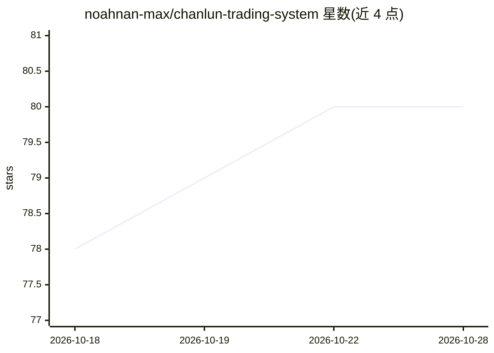

# noahnan-max/chanlun-trading-system

⭐ 80 · Python · NOASSERTION · 推送 2026-08-03 · [GitHub](https://github.com/noahnan-max/chanlun-trading-system) · 个人维护 · 中文 README

**缠论技术分析的 AI Agent Skill：规则化分析流程与自检门**

把缠中说禅技术分析体系做成可装入 AI Agent 的 Skill：强制执行‘先定级别、先认结构、先写失效点’的分析流程，核心是八道自检门（级别→结构→类型→比较→买卖点→触发→风险→降级），任一步缺失则输出降级为‘观察’。覆盖 A 股/港股/ETF/指数/期货，明确不荐股、不下单。另附本地优先的可视研究工作台（uv 运行，CSV 导入，内置合成示例），线段/中枢/背驰标注为 research_proxy 而非严格原著实现。Skill 与工作台为两个独立安装单元。

## 筛选速览

| 维度 | 判定 | 备注 |
|---|---|---|
| AI 角色 | `ai-ecosystem` | LLM/agent 周边工具 |
| 许可风险 | `none` | NOASSERTION |
| 部署形态 | `None` |  |
| 模型依赖 | — | README 未给出锁定关系 |
| 硬件要求 | — | 无带数字的原话,不猜 |
| 安装摩擦 | `low` | 无编译、无系统依赖或容器化 |
| 成熟度 | — | 结构信号不足 |

## 能力要点

- 八道自检门的强制纪律分析流程，缺步自动降级为观察
- SKILL.md 可加载到 Claude Code、Codex、任意 AI（通用中文版整段复制即用）
- 本地可视研究工作台：标注分型/笔/中枢/买卖点候选及近似损失
- 数据不足时显式降级并说明近似损失，区分严格定义与可测代理

## 适用场景

- 让 AI Agent 按缠论规则分析标的走势并输出带失效点的观察结论
- 在 Claude Code / Codex 中安装该 Skill 做规则化技术分析研究
- 用本地工作台导入 CSV 标注笔、中枢、背驰证据并复核

## 场景标签

`金融量化` · 领域:学习与行业

## 证据(README 行号)

> L3: 把**缠中说禅（缠论）**的技术分析体系，做成一个可以直接装进 AI Agent 的 **Skill**——让 AI 帮你看 A 股 / 港股 / ETF / 指数 / 期货的走势时，**先定级别、先认结构、先写失效点**，而不是张
> L16: 核心是一道**自检门（Audit Gate）**：级别门 → 结构门 → 类型门 → 比较门 → 买卖点门 → 触发门 → 风险门 → 降级门。任何一步缺失，输出自动从"确认买入"退回"观察"。
> L94: ├── SKILL.md            # 主文件：规则 + 自检门 + 工作流 + 输出模板

## 星数曲线

2026-10-18 78 → 2026-10-28 80（+2）

---
*卡片 v1 · prompt 1.4 · 生成 2026-10-24 · 置信度 high · 依据 README sha `9eb31e9e6a48` · [字段定义](../../DATASET.md)*
