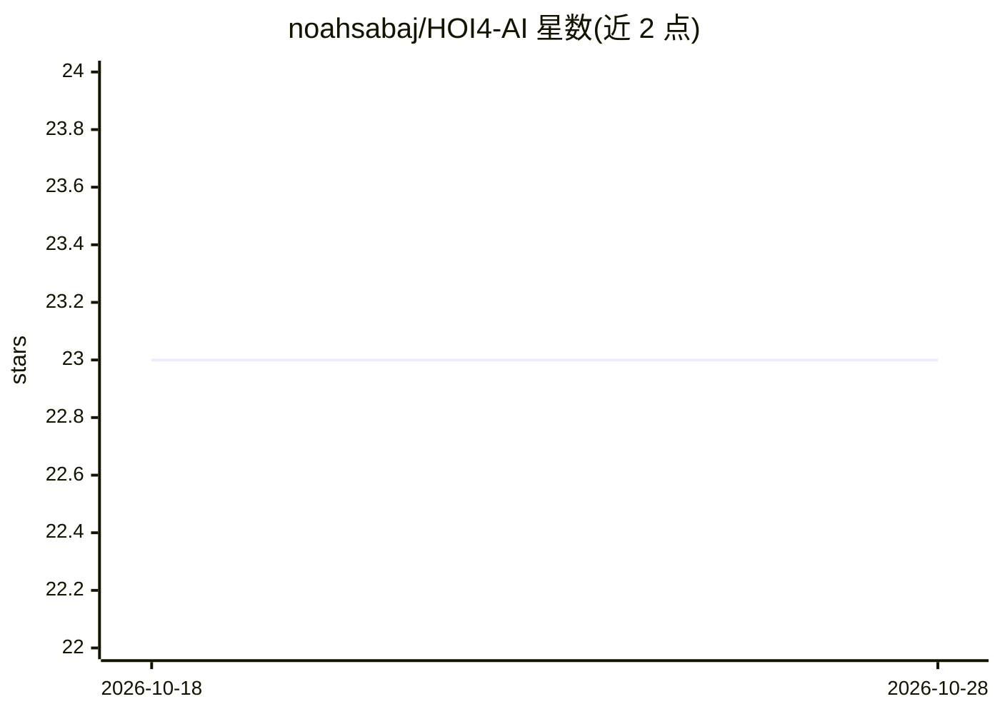

# noahsabaj/HOI4-AI

⭐ 24 · Python · NOASSERTION · 推送 2026-09-27 · [GitHub](https://github.com/noahsabaj/HOI4-AI) · 个人维护

**用计算机视觉与强化学习让 AI 自学玩钢铁雄心4的研究原型**

研究原型，目标是让策略仅凭截图学习游玩 HOI4：截屏经视频编码器与细节裁剪、GRU 记忆，直接输出原始鼠标/键盘事件，无世界状态 API 或规划器。Python 负责录制、训练与对局协调，Rust Windows worker 负责像素捕获与输入施加；支持第二 PC 机群节点、Linux 站点、人类游玩录制、课程式阶梯训练（rung saves）与 BC 训练。README 明确声明尚无训练完成的战斗 agent，战斗与双机自博弈未验证。需要 Windows、PowerShell 7.5+、HOI4、Rust、uv、ffmpeg。

## 筛选速览

| 维度 | 判定 | 备注 |
|---|---|---|
| AI 角色 | `ai-native` | 本体是模型或模型工具 |
| 许可风险 | `none` | NOASSERTION |
| 部署形态 | `desktop` | 安装包/桌面程序 |
| 模型依赖 | — | README 未给出锁定关系 |
| 硬件要求 | — | 无带数字的原话,不猜 |
| 安装摩擦 | `high` | 编译与系统依赖俱全 |
| 成熟度 | `idea` | |

## 能力要点

- 截图→视频编码+裁剪→GRU→原始鼠标键盘事件的端到端直连策略
- Rust worker 做像素捕获与输入施加，附带 F12 急停与失焦释放按键
- 两机配对（fleet tunnel/TLS）与 Linux X11 站点复用同一协议
- 阶梯式课程训练（rung-games/train-bc）与人类游玩录制流程

## 适用场景

- 录制自己游玩 HOI4 的数据用于行为克隆训练
- 在第二台 PC 上跑评估、录制与训练会话
- 研究从像素直接生成鼠标键盘操作的 game-playing agent

## 场景标签

`强化学习` `GUI 自动化` · 领域:效率与自动化

## 证据(README 行号)

> L5: One direct policy: screenshots → video encoder and detail crops → GRU memory → raw mouse/keyboard events. The deploy
> L11: **Research prototype; no trained combat agent yet.** See STATUS.md for measured results and outstanding acceptance 

## 星数曲线

2026-10-18 23 → 2026-10-28 23（+0）

---
*卡片 v1 · prompt 1.4 · 生成 2026-10-27 · 置信度 high · 依据 README sha `22197fd511c4` · [字段定义](../../DATASET.md)*
