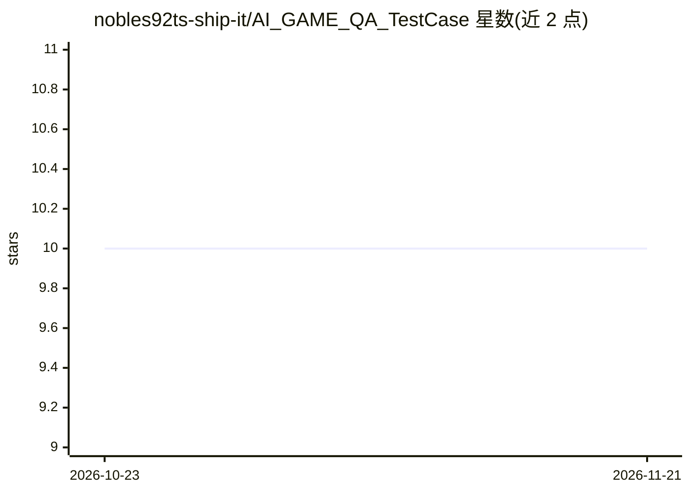

# nobles92ts-ship-it/AI_GAME_QA_TestCase

⭐ 10 · JavaScript · 推送 2026-11-13 · [GitHub](https://github.com/nobles92ts-ship-it/AI_GAME_QA_TestCase) · [官网](https://nobles92ts-ship-it.github.io/en/built/tc-team/) · 个人维护 · 中文 README

**游戏 QA 测试用例自动生成流水线：LLM 写句子，代码管结构**

面向游戏 QA 团队的测试用例生成流水线，基于 Claude Code CLI 运行：读入规格（Confluence URL/PDF/Word/Excel），经 S0–S7 八个阶段产出经审核的测试用例表。LLM 负责读规格、设计覆盖、撰写用例句子与对抗性评审；确定性代码负责规则切分、行结构、7 个门控、覆盖台账与置信度打分（R1–R7 规则，零 LLM 调用）。门控失败即停止等待人工处理。默认写入 Google Sheets，另有输出 Markdown 包供 AI agent 执行的 AI edition。需 Node.js 与 Claude Code CLI，一次运行处理一个功能。

## 筛选速览

| 维度 | 判定 | 备注 |
|---|---|---|
| AI 角色 | `ai-native` | 本体是模型或模型工具 |
| 许可风险 | `none` | — |
| 部署形态 | `library` | 以包/库形式分发 |
| 模型依赖 | locked-api |  |
| 硬件要求 | — | 无带数字的原话,不猜 |
| 安装摩擦 | `low` | 无编译、无系统依赖或容器化 |
| 成熟度 | — | 结构信号不足 |

## 能力要点

- 7 个确定性门控（设计/内容/重复/来源/覆盖封印/快照 diff/追溯），门控判定不经模型
- 零 LLM 调用的规则置信度打分，指示评审者注意力分配
- 4 种输入格式自动识别：Confluence URL/PDF/Word/Excel
- AI edition 输出 Markdown 包供 AI agent 直接执行 QA

## 适用场景

- 从 Confluence 规格自动生成游戏功能的测试用例表
- 用确定性门控拦截虚构需求与重复用例行
- 为 AI agent 生成可执行的 QA Markdown 用例包
- 按 ISTQB 测试设计技术（等价类/边界值/状态迁移）组织用例设计

## 场景标签

 · 领域:软件开发/QA 自动化

## 证据(README 行号)

> L13: > **Deterministic game-QA test-case pipeline.**
> L34: - **Two lanes, strictly separated** — the LLM writes sentences and makes judgment calls; **deterministic code owns 
> L81: |**S1**|Design|**LLM** (Opus 5.5 designer · Sonnet inspection)|Spec analysis → coverage design → cross-reference → 

## 星数曲线

2026-10-23 10 → 2026-11-21 10（+0）

---
*卡片 v1 · prompt 1.4 · 生成 2026-11-19 · 置信度 high · 依据 README sha `54f9b8cfdf65` · [字段定义](../../DATASET.md)*
