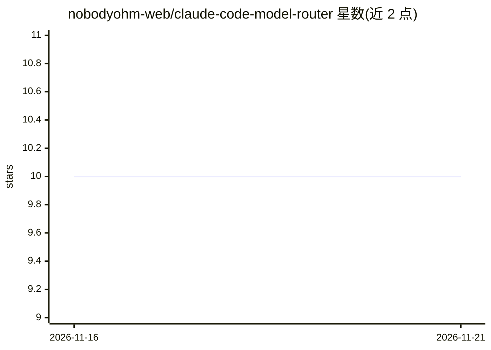

# nobodyohm-web/claude-code-model-router

⭐ 10 · Shell · MIT · 推送 2026-07-10 · [GitHub](https://github.com/nobodyohm-web/claude-code-model-router) · 个人维护

**为 Claude Code 按任务复杂度自动分配模型与推理档位的路由插件**

以 Claude Code 插件形式安装的模型路由器：内置 UserPromptSubmit 钩子对每条提示做本地启发式分类（可选 Haiku 回退），注入一行路由提示；五个绑定不同模型与 effort 的子代理承接实际分发（Haiku→Sonnet→Opus→Fable）；PreToolUse 钩子记录分发到本地 JSONL 台账，/router-stats 输出各层分发表、主循环 token 与估算节省金额。提供三种姿态（quality-first/balanced/max-savings）与端到端可配置项。限制：无法在会话中切换主模型，节省金额为估算值。

## 筛选速览

| 维度 | 判定 | 备注 |
|---|---|---|
| AI 角色 | `ai-ecosystem` | LLM/agent 周边工具 |
| 许可风险 | `permissive` | MIT |
| 部署形态 | `None` |  |
| 模型依赖 | — | README 未给出锁定关系 |
| 硬件要求 | — | 无带数字的原话,不猜 |
| 安装摩擦 | `low` | 无编译、无系统依赖或容器化 |
| 成熟度 | — | 结构信号不足 |

## 能力要点

- 钩子每回合主动分类提示并注入路由提示，本地启发式零 API 成本
- 五个固定模型的分层子代理（Haiku/Sonnet/Opus/Fable + effort 档位）
- JSONL 分发台账与 /router-stats 统计各层实际执行情况
- 分层/分类器/定价全部集中在单一 config 文件可配置

## 适用场景

- 降低 Claude Code 日常编码任务的 token 消耗
- 让简单搜索/格式化走小模型、复杂设计走大模型
- 审计每轮任务实际由哪个模型执行

## 场景标签

`模型网关` · 领域:Agent 开发

## 证据(README 行号)

> L3: A token-economical, quality-first **model & effort router** for Claude Code — now an installable plugin that activel
> L5: Claude Code has no built-in router that switches models by task complexity. v1 of this project added one as a static
> L47: /plugin marketplace add nobodyohm-web/claude-code-model-router

## 星数曲线

2026-11-16 10 → 2026-11-21 10（+0）

---
*卡片 v1 · prompt 1.4 · 生成 2026-11-19 · 置信度 high · 依据 README sha `104c4f15e6c2` · [字段定义](../../DATASET.md)*
