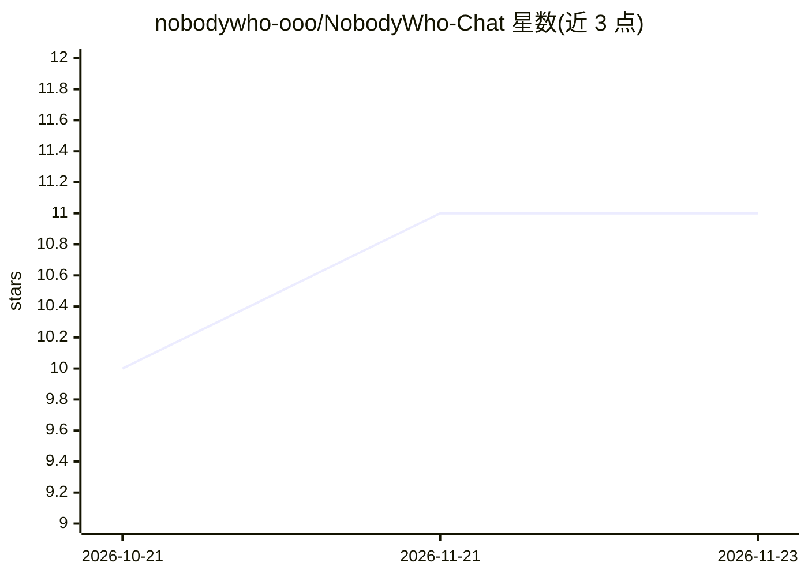

# nobodywho-ooo/NobodyWho-Chat

⭐ 11 · TypeScript · EUPL-1.2 · 推送 2026-11-22 · [GitHub](https://github.com/nobodywho-ooo/NobodyWho-Chat) · [官网](https://github.com/nobodywho-ooo/nobodywho) · 组织维护

**手机上完全离线运行的本地 LLM 聊天助手**

基于 React Native 的移动端 AI 聊天应用，构建于 NobodyWho 库之上，底层使用 llama.cpp 在设备本地运行 LLM。支持流式聊天输出、工具调用（自定义函数）、多模态图像与音频输入。全部对话在本地进行，无需联网、无账号与订阅。提供 App Store 与 Google Play 下载，开发者可从源码构建，需 npm 安装依赖并配置 Sentry 属性文件，含 Android APK/AAB 构建与 iOS Xcode 运行流程。

## 筛选速览

| 维度 | 判定 | 备注 |
|---|---|---|
| AI 角色 | `ai-native` | 本体是模型或模型工具 |
| 许可风险 | `viral` | EUPL-1.2 |
| 部署形态 | `library` | 以包/库形式分发 |
| 模型依赖 | — | README 未给出锁定关系 |
| 硬件要求 | — | 无带数字的原话,不猜 |
| 安装摩擦 | `low` | 无编译、无系统依赖或容器化 |
| 成熟度 | — | 结构信号不足 |

## 能力要点

- 完全离线运行，对话数据不离开设备，无需联网与账号
- 本地 LLM 流式实时输出，底层为 llama.cpp
- 支持工具调用（自定义函数如天气、股价）
- 多模态模型支持图像与音频输入

## 适用场景

- 在无网络环境下使用 AI 助手
- 对隐私有要求、不希望对话数据上云的用户
- 为 Android/iOS 构建本地 LLM 应用

## 场景标签

`AI 助手` · 领域:对话与助手

## 证据(README 行号)

> L10: NobodyWho Chat is a fully offline, private AI assistant that runs entirely on your device. Every conversation happe
> L12: Built with **NobodyWho**, a library designed to run LLMs locally and efficiently on any device, using the wonderful

## 星数曲线

2026-10-21 10 → 2026-11-23 11（+1）

---
*卡片 v1 · prompt 1.4 · 生成 2026-11-19 · 置信度 high · 依据 README sha `6bffce1451e2` · [字段定义](../../DATASET.md)*
