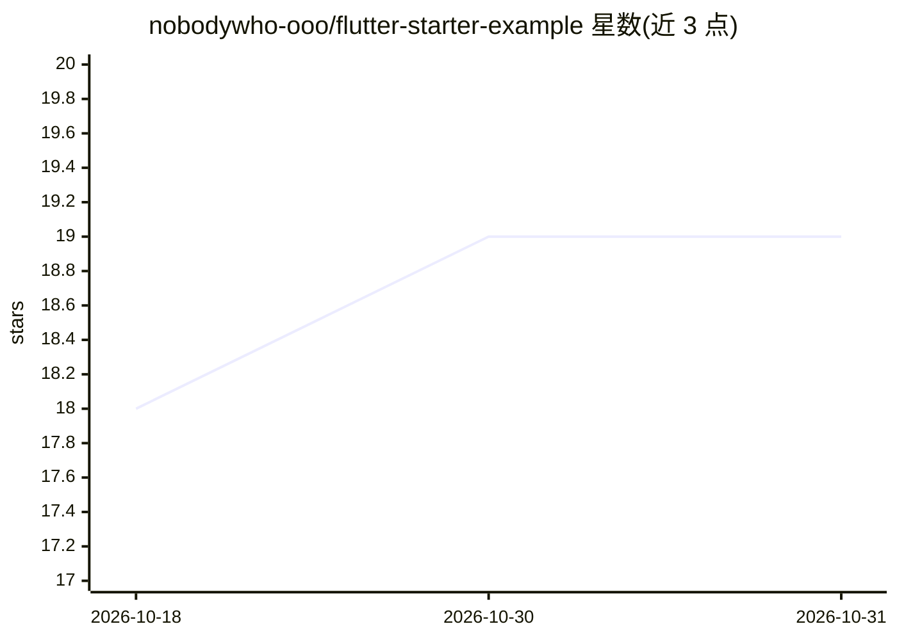

# nobodywho-ooo/flutter-starter-example

⭐ 19 · Dart · EUPL-1.2 · 推送 2026-10-29 · [GitHub](https://github.com/nobodywho-ooo/flutter-starter-example) · [官网](https://github.com/nobodywho-ooo/nobodywho) · 组织维护

**NobodyWho 本地 LLM 库的 Flutter 示例启动应用**

演示 NobodyWho 库能力的 Flutter 示例应用：NobodyWho 是在设备本地运行 LLM 的库。示例覆盖本地 LLM 聊天流式输出、工具调用、多模态图像与音频输入、嵌入与 RAG 语义检索、语音转文字与文字转语音。模型以 GGUF 格式从 Hugging Face 下载（支持 hf:// 与 HTTP URL，本地缓存），或在生产中按需下载。已在 iOS、Android、macOS 测试，Flutter Web 不支持。给出设备最低推荐配置。

## 筛选速览

| 维度 | 判定 | 备注 |
|---|---|---|
| AI 角色 | `ai-ecosystem` | LLM/agent 周边工具 |
| 许可风险 | `viral` | EUPL-1.2 |
| 部署形态 | `None` |  |
| 模型依赖 | local-ok | 支持本地模型 |
| 硬件要求 | — | 无带数字的原话,不猜 |
| 安装摩擦 | `low` | 无编译、无系统依赖或容器化 |
| 成熟度 | — | 结构信号不足 |

## 能力要点

- 本地 LLM 聊天流式输出与工具调用
- 多模态图像/音频输入、嵌入与 RAG 检索
- STT（Whisper）与 TTS（Kokoro/Pocket TTS/Supertonic 3）
- hf:// URL 直接加载模型并本地缓存

## 适用场景

- 在 Flutter 应用中集成本地 LLM 聊天与工具调用
- 移动端原型开发：加载 GGUF 模型做多模态与 RAG
- 参考示例实现按需下载模型与设备适配

## 场景标签

`RAG` `语音合成` `语音识别` `多模态` · 领域:内容生成

## 证据(README 行号)

> L9: This starter app demonstrates the capabilities of **NobodyWho**, a library designed to run LLMs locally and efficien
> L13: - **Chat** — stream responses from a local LLM

## 星数曲线

2026-10-18 18 → 2026-10-31 19（+1）

---
*卡片 v1 · prompt 1.4 · 生成 2026-10-29 · 置信度 high · 依据 README sha `6f3aa58855d1` · [字段定义](../../DATASET.md)*
