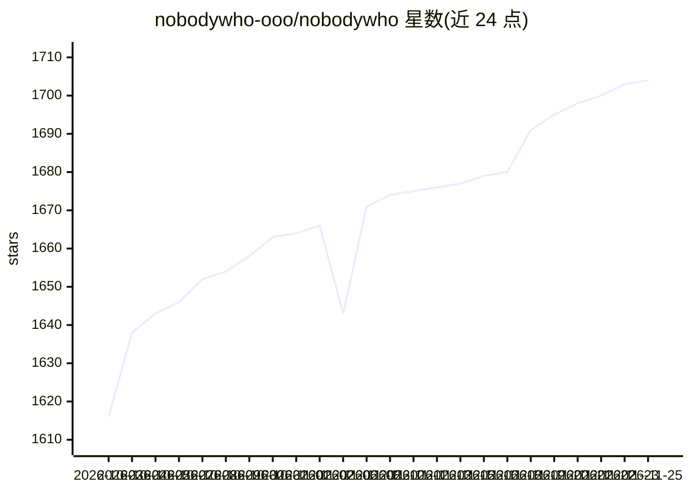

# nobodywho-ooo/nobodywho

⭐ 1,704 · Rust · EUPL-1.2 · 推送 2026-11-19 · [GitHub](https://github.com/nobodywho-ooo/nobodywho) · [官网](https://nobodywho.ai) · 组织维护

**让开发者在本地设备上运行 GGUF 格式 LLM 的推理引擎**

面向多端应用开发的本地 LLM 推理引擎，底层基于 llama.cpp，通过 Kotlin、Swift、React Native/Expo、Flutter、Python、Godot 六种绑定分发到 Maven Central、SPM、npm、pub.dev、PyPI 与 Godot AssetLib。支持运行任意 GGUF 格式聊天模型、从函数签名自动生成工具调用语法、图像/音频多模态输入、Whisper 转写与 Kokoro 等语音合成，另提供实现 OpenAI Chat Completions API 的实验性本地服务器。限制：不支持 Windows ARM64 与 web 导出，Godot 无 iOS 导出。

## 筛选速览

| 维度 | 判定 | 备注 |
|---|---|---|
| AI 角色 | `ai-ecosystem` | LLM/agent 周边工具 |
| 许可风险 | `viral` | EUPL-1.2 |
| 部署形态 | `desktop` | 安装包/桌面程序 |
| 模型依赖 | local-ok | 支持本地模型 |
| 硬件要求 | — | 无带数字的原话,不猜 |
| 安装摩擦 | `low` | 无编译、无系统依赖或容器化 |
| 成熟度 | — | 结构信号不足 |

## 能力要点

- 六种语言/平台绑定（Kotlin/Swift/React Native/Flutter/Python/Godot）
- 支持任意 GGUF 模型，可从 Hugging Face 引用或任意 URL 加载
- 从函数签名自动生成结构化工具调用语法
- 多模态输入、语音转写/合成与语音活动检测

## 适用场景

- 在移动应用中离线集成 LLM 对话能力
- 为 Godot 游戏接入本地模型与语音功能
- 用本地服务器向本机应用提供 OpenAI 兼容接口

## 场景标签

`推理引擎` · 领域:训练与推理

## 证据(README 行号)

> L13:  NobodyWho is an inference engine that lets you run LLMs locally and efficiently.
> L38: * Powered by the wonderful llama.cpp
> L46: |**Kotlin**|Maven Central|Desktop, Android|docs.nobodywho.ooo/kotlin|

## 星数曲线

2026-10-23 1,616 → 2026-11-25 1,704（+88）

---
*卡片 v1 · prompt 1.4 · 生成 2026-11-23 · 置信度 high · 依据 README sha `41d63095f1b2` · [字段定义](../../DATASET.md)*
