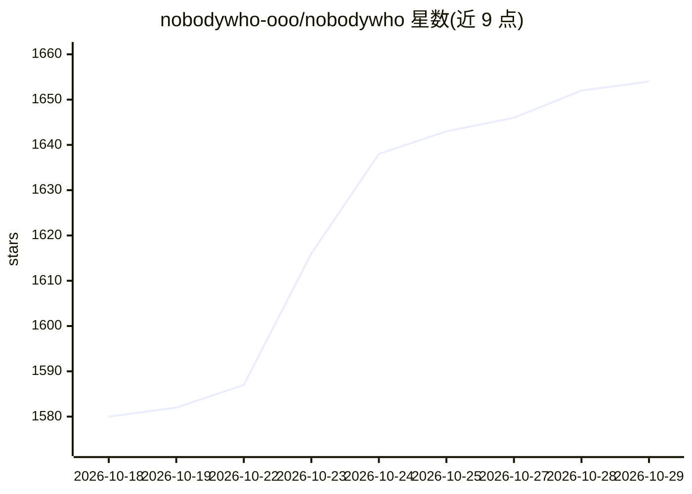

# nobodywho-ooo/nobodywho

⭐ 1,654 · Rust · EUPL-1.2 · 推送 2026-10-28 · [GitHub](https://github.com/nobodywho-ooo/nobodywho) · [官网](https://nobodywho.ai) · 组织维护

**多平台本地 LLM 推理引擎，提供六种语言绑定**

基于 llama.cpp 的本地推理引擎，以 Kotlin、Swift、React Native/Expo、Flutter、Python、Godot 六种绑定形式嵌入应用，在桌面与移动设备上离线运行 GGUF 格式的任意聊天 LLM。支持 Vulkan/Metal GPU 加速、显存不足时部分层卸载到 CPU，提供工具调用语法自动生成、图像/音频多模态输入、Kokoro/Whisper/Silero 等语音能力，以及 Hugging Face 模型下载与实验性 OpenAI 兼容本地服务器。限制：无 Web 导出、Windows ARM64 不支持、Godot 无 iOS 导出。

## 筛选速览

| 维度 | 判定 | 备注 |
|---|---|---|
| AI 角色 | `ai-ecosystem` | LLM/agent 周边工具 |
| 许可风险 | `viral` | EUPL-1.2 |
| 部署形态 | `desktop` | 安装包/桌面程序 |
| 模型依赖 | local-ok | 支持本地模型 |
| 硬件要求 | — | 无带数字的原话,不猜 |
| 安装摩擦 | `low` | 无编译、无系统依赖或容器化 |
| 成熟度 | `idea` | |

## 能力要点

- 六种语言/引擎绑定，覆盖桌面（Linux/macOS/Windows）与 iOS/Android
- 运行任意 GGUF 模型，支持 hf:owner/repo:QUANT 引用自动下载
- 工具调用结构化语法自动生成、多模态输入、TTS/STT/VAD
- 实验性本地服务器实现 OpenAI Chat Completions API

## 适用场景

- 在 Flutter/Godot/原生应用中嵌入离线运行的 LLM 对话能力
- 移动端 App 集成本地语音对话（STT+LLM+TTS）
- 通过 OpenAI 兼容接口在本地提供模型服务

## 场景标签

`推理引擎` · 领域:训练与推理

## 证据(README 行号)

> L14:  NobodyWho is an inference engine that lets you run LLMs locally and efficiently.
> L37: * Compatible with thousands of pre-trained LLMs — use any LLM in the GGUF format

## 星数曲线

2026-10-18 1,580 → 2026-10-29 1,654（+74）

---
*卡片 v1 · prompt 1.4 · 生成 2026-10-21 · 置信度 high · 依据 README sha `5195ee07e60d` · [字段定义](../../DATASET.md)*
