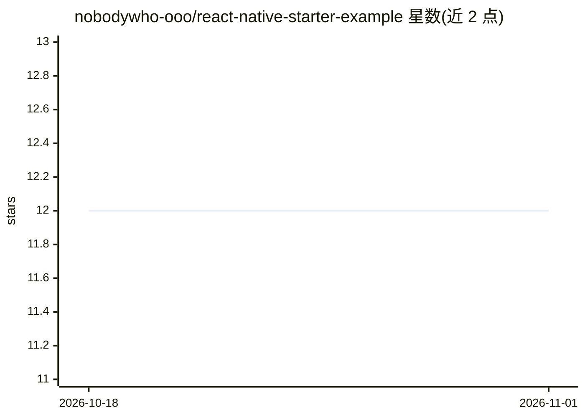

# nobodywho-ooo/react-native-starter-example

⭐ 12 · TypeScript · EUPL-1.2 · 推送 2026-10-28 · [GitHub](https://github.com/nobodywho-ooo/react-native-starter-example) · [官网](https://github.com/nobodywho-ooo/nobodywho) · 组织维护

**演示 NobodyWho 本地 LLM 库的 React Native 入门示例应用**

面向开发者的 React Native 启动示例，展示 NobodyWho 库在移动端本地运行 LLM 的能力：流式聊天、工具调用、多模态图像与音频输入、嵌入与 RAG（含 cross-encoder 重排序）、语音转文字与文字转语音。模型从 Hugging Face 下载 .gguf 文件或以 hf:// URL 直接加载并本地缓存；兼容多数 GGUF 模型，建议移动端使用 1GB 以下模型且可用 RAM 至少为模型体积两倍。TTS 支持 Kokoro、Pocket TTS、Supertonic 3，STT 支持 Whisper。

## 筛选速览

| 维度 | 判定 | 备注 |
|---|---|---|
| AI 角色 | `ai-ecosystem` | LLM/agent 周边工具 |
| 许可风险 | `viral` | EUPL-1.2 |
| 部署形态 | `library` | 以包/库形式分发 |
| 模型依赖 | local-ok | 支持本地模型 |
| 硬件要求 | — | 无带数字的原话,不猜 |
| 安装摩擦 | `low` | 无编译、无系统依赖或容器化 |
| 成熟度 | — | 结构信号不足 |

## 能力要点

- 本地 LLM 流式聊天与工具调用
- 多模态图像/音频输入与嵌入+重排序 RAG
- 支持 hf:// URL 与 HTTP 下载 GGUF 模型并本地缓存
- TTS（Kokoro/Pocket TTS/Supertonic 3）与 STT（Whisper）

## 适用场景

- 我想快速搭建一个带本地 LLM 的 React Native 应用
- 在手机上试验离线聊天、语音输入与语音合成
- 学习如何按需下载并缓存端侧模型

## 场景标签

 · 领域:移动端/端侧 AI 开发

## 证据(README 行号)

> L10: This starter app demonstrates the capabilities of **NobodyWho**, a library designed to run LLMs locally and efficie
> L14: - **Chat** — stream responses from a local LLM

## 星数曲线

2026-10-18 12 → 2026-11-01 12（+0）

---
*卡片 v1 · prompt 1.4 · 生成 2026-11-01 · 置信度 high · 依据 README sha `0670f855de5d` · [字段定义](../../DATASET.md)*
